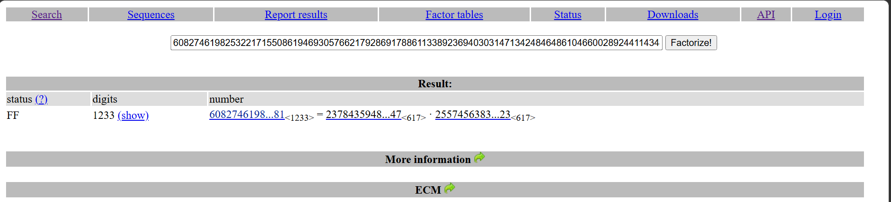
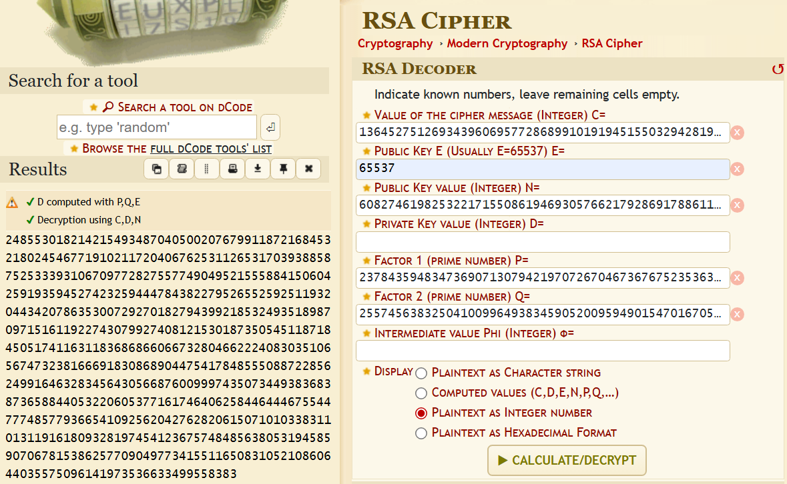

For this task, the only thing we have been provided is `rsa.enc` which includes 3 values - `n`, `e`, and `c`. The file name including `rsa` indicates that we are dealing with the RSA encryption algorithm, which means we know what each of these values represent. `c` is the ciphertext which we are trying to convert into plaintext, and `n` and `e` are the public key components. As there is nothing else to work on, we can assume that the goal is to convert the ciphertext (`c`) into plaintext. As we only have `n` and `e`, the options are limited. However, it may be possible to derive `p` and `q` from `n` to derive the private key and decrypt this ciphertext (as `n = pq`). Although `n` is a large number (approximately $2^{2048}$), we could try factorising it - the RSA algorithm has not yet been broken for keys this wide, but this could be one of the numbers which have been fully factorised. One of the places that keeps this information is http://factordb.com, so we can try this first. \

It looks like we immediately have the 2 factors for `n`, which are `p` and `q`. Now that we know `p`, `q`, `e`, and `n`, we have basically everything we need to decrypt `c`. This information can be copied into an online RSA decoder such as https://www.dcode.fr/rsa-cipher to get the plaintext. \

This has given us the plaintext, which is another large number - likely to be the other half of the private key for the next phase.