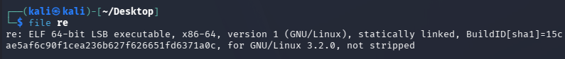
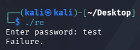
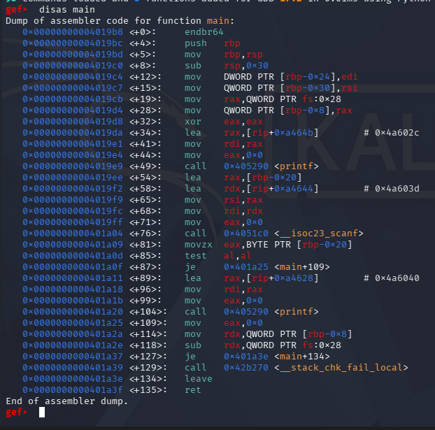
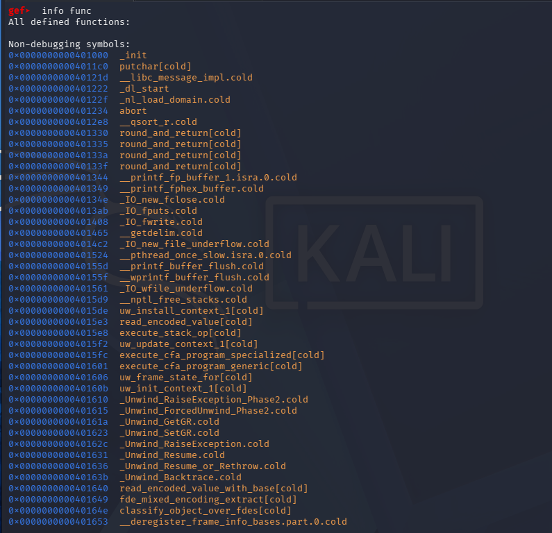
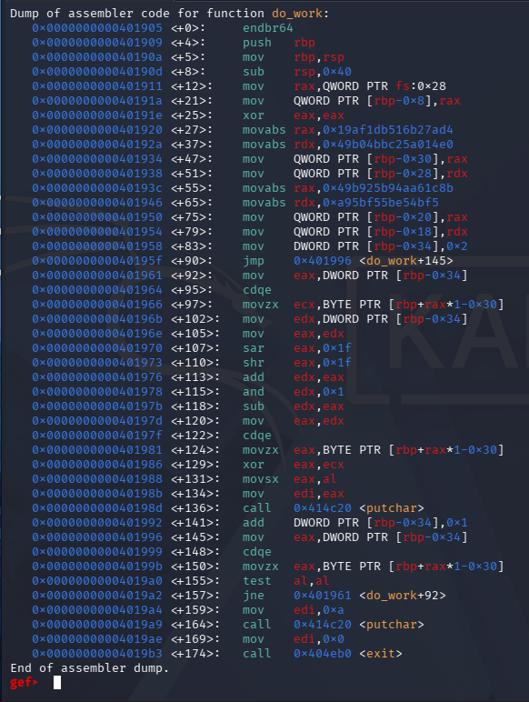
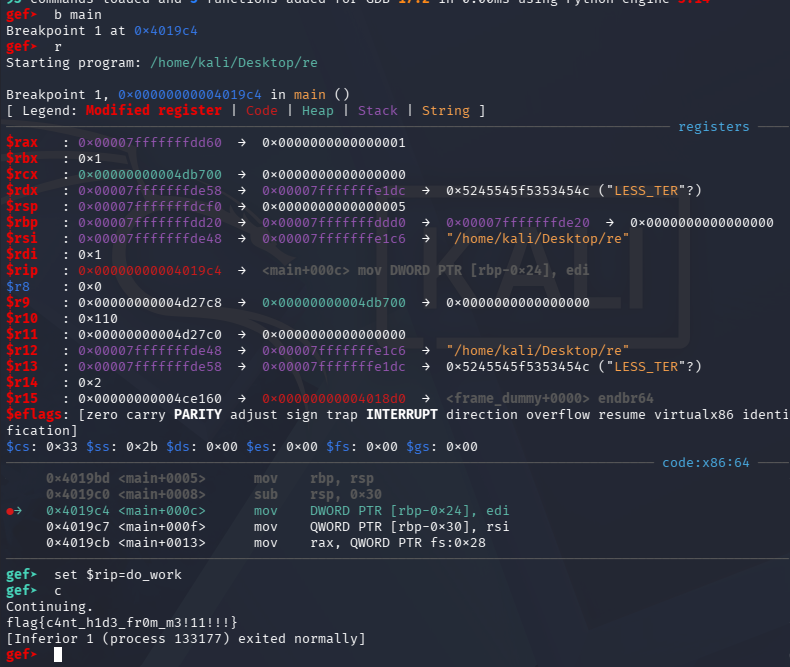

This vulnerability only requires `gef`, but `strings` and `ghidra` may be useful too.

To begin, the binary can be inspected using `file re` to gain some information about its structure and how it was compiled since this could give us an indication of how it is vulnerable. \

The binary seems to be pretty standard. The only notable aspects are that it is statically linked and not stripped, which could be exploited. However, we need more information. To see what the binary actually does, we can run it and see what happens. \

The binary asks for a password, and since we don't know what it is returns failure. It is possible that the password has just been written in plaintext in the binary, so we can dump the strings from the binary to investigate. However, as the binary is statically linked, there is a lot of noise in the binary. This dumps the strings from every single library that has been compiled with the binary, which makes it hard to determine what is unique to the binary and what was from a library. As such, we need to take another approach. Using a debugger like `gef` seems like the obvious next step, so we can try that. The obvious thing to do would be to see what the `main` function does, so that can be disassembled. \

From this disassembly, there doesn't seem to be anything of note. There's only a `scanf` call and 2 `printf` calls (both of which have already been seen) but nothing immediately jumps out. There does seem to be a comparison at some point with the `je` instruction, but no obvious comparison values. As there is nothing else to go on, seeing what functions are in the program might be helpful - nothing is called by `main()`, but that doesn't mean that there isn't anything that could give a hint to the solution. \

The program, as expected, has a lot of functions due to the previously identified static linking. However, after going through the whole list, there is one function that stood out - `do_work()`. This is not part of any library and not called by `main` so its purpose isn't clear, but it's worth investigating. For now, disassembling it seems like the natural next step. \

This function seems to be doing quite a bit more work than `main`. There are some `putchar` function calls, which seems like a natural place for the flag to be. Although this function is not called from `main`, it doesn't need to be. The `rip` register, which stores the address for the next instruction to execute, can be directly manipulated using `gef`. By setting `rip` to the start of this function, we can execute the function and see what it does. \

This prints the flag immediately with no other work required. This function would have never been found without reverse engineering it, so this binary has been completely reverse engineered.