This vulnerability is solved using `gef`. To begin, the program must be called using `gef ./rand`. However, trying to run the program at all leads to an error - the program uses the `ptrace()` function to exit immediately if a debugger is detected which is a common strategy used by programs.
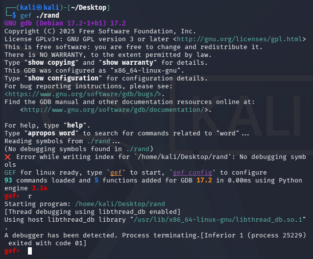

The program can still be disassembled using `disas main` to inspect what it does. This is where the `ptrace` call in the program can be found.
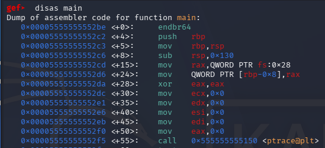

If the binary's properties are checked using `file rand`, an observer may notice that the binary is dynamically linked using the system's libraries at runtime. This can be confirmed by looking at the output of a statically linked binary, which explicitly says that.
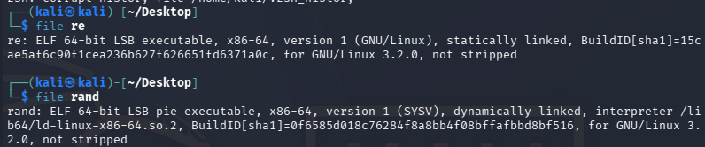

Although this makes the binary smaller since it doesn't have to include any system functions, it becomes vulnerable to an `LD_PRELOAD` attack. `LD_PRELOAD` is an environment variable which is used to find shared libraries for system functions. This can be exploited by writing a custom `ptrace` library routine that always returns 0 to bypass this debug check entirely. This is a simple C script that defines the `ptrace` function, such as the following:
```c
long ptrace(int request, int pid, void *addr, void *data) {
    return 0;
}
```

To make this available as a shared library, it can be compiled as `gcc -shared ptrace.c -o ptrace.so`. This can then be put into the environment in `gef` using `set environment LD_PRELOAD=./ptrace.so`, which will cause any `ptrace()` call to use this function instead.
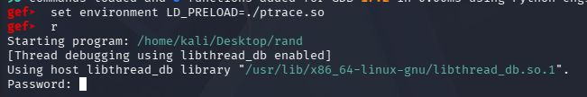

Now that we are into the program, we can actually investigate it. It seems to be asking for a password, but we don't know what the password is so we'll have to look elsewhere. The first place to investigate would be any embedded strings in the program, which can be dumped using `strings rand`.
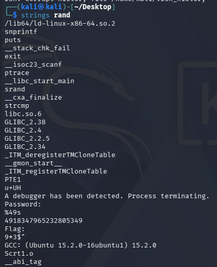

There are several notable strings that can be found in the program. There's the debugger string seen earlier, the password entry text, a random string of numbers (`4918347965232805349`), and a piece of string that seems to imply that the flag is printed somewhere (but likely obfuscated in some form). The string of numbers is interesting, and could be the password so we can try it and see what happens.
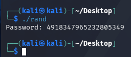

This has caused nothing to happen, so some more investigation is necessary. As identified earlier, the binary isn't stripped so we could take a look at what functions the binary includes.
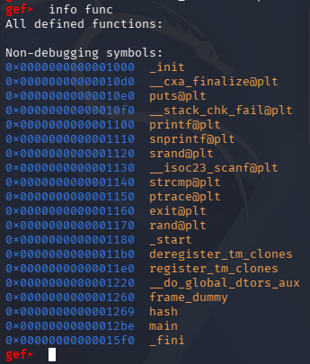

These are all C and system functions, with the exceptions of `main` and `hash`. `main` isn't interesting since all standlone C binaries will include one, but `hash` is interesting and could indicate that the password is hashed and perhaps that's what the random string of numbers was. We don't expect `hash` to contain any useful information since it just sounds like a hashing function, so exploring `main` again will be the next step. Just to make it easier, this will be done using Ghidra.
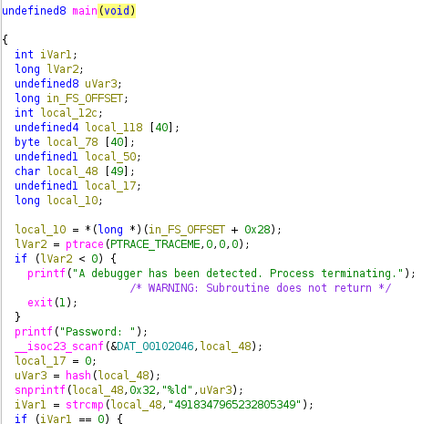

This decompilation of `main` produced by Ghidra has a few points of interest:
- The `ptrace` call definitely terminates if it succeeds
- The input is hashed and passed as a string
- The hash is compared to `4918347965232805349`
To make viewing this decompilation easier, the variables can be renamed.
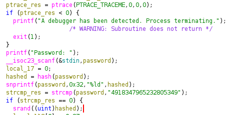

After cleaning up the decompilation, it seems like the hash value is used to seed a random number generator. However, to enter this branch the first thing we need to do is find a password that hashes to the value `4918347965232805349`. This could be brute forced, but this will take a long time. Instead, we can use `gef` to insert this value into memory just before the string comparison to enter the branch. This requires looking at the assembly to find out where the password input is stored in memory so we can adjust its value.
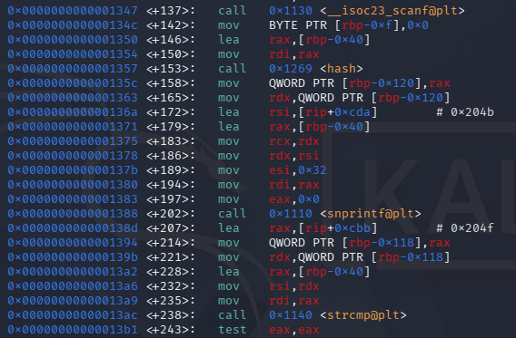

At various points, there are a few addresses that have data being transferred into them:
- `rbp - 0xf`
- `rbp - 0x120`
- `rbp - 0x40`
- `rbp - 0x118`
The one that sticks out the most is in the instructions before the `hash` function is called. The `lea` instruction is used to move the memory held in `rbp - 0x40` to the `rax` register. This is then moved to the `rdi` register, which is where the first argument for functions is stored. As the `hash` function is called directly afterwards, this seems like the perfect candidate for where password input is stored. To confirm this, a breakpoint can be placed just before the `hash` function (using `b *0x1239`) and the `rdi` register inspected.
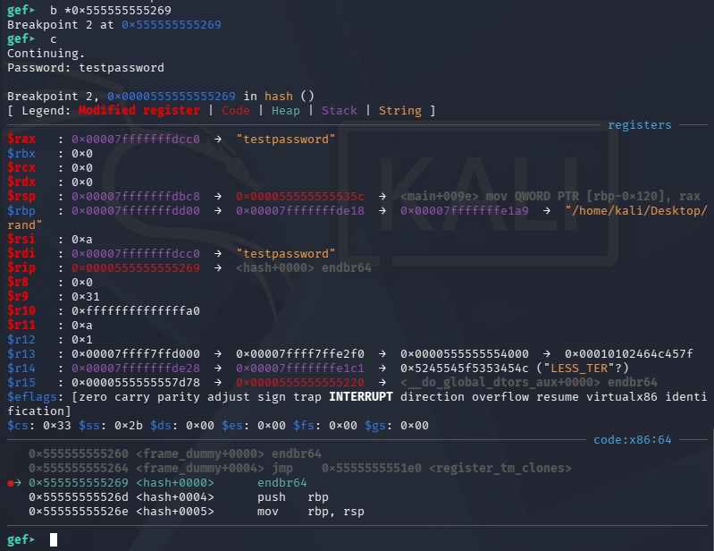

As expected, the `rdi` register (and `rax` register) contains the input password. Therefore, the input password is contained at `rbp - 0x40`. We can utilise this fact to force this memory to be the hash value, bypassing the need to find the password entirely. This can be done by setting a breakpoint at the `strcmp` instruction, changing the value of `rbp - 0x40` (using `set {char[20]}($rbp-0x40)`) to the "correct" hash value, and then continuing function execution.
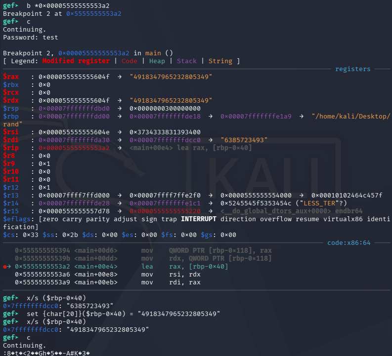

As shown, this has actually allowed program execution to continue within the branch. However, the output does not look as expected. This probably has something to do with the random seed identified earlier, which was identified earlier to use the hashed value. Since changing the value at `rbp-0x40` only changed the string representation, we also need to change the value of the hash value itself. In the earlier disassembled code, `rbp-0x120` seems like a good candidate since that is the value accessed directly after the `hash` function returns so we can inspect that.
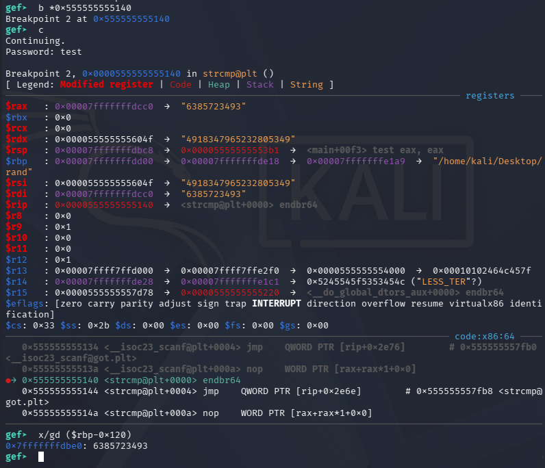

As shown, the address at `rbp - 0x120` holds the exact same value (in decimal) as `rdi` (which, in this case, is the string representation of the hash of the password input). As such, it can be changed using `set {long}($rbp - 0x120)` to ensure that both `rbp - 0x120` and `rbp - 0x40` hold the same value. If both of these are changed and the program execution continues, the following results:
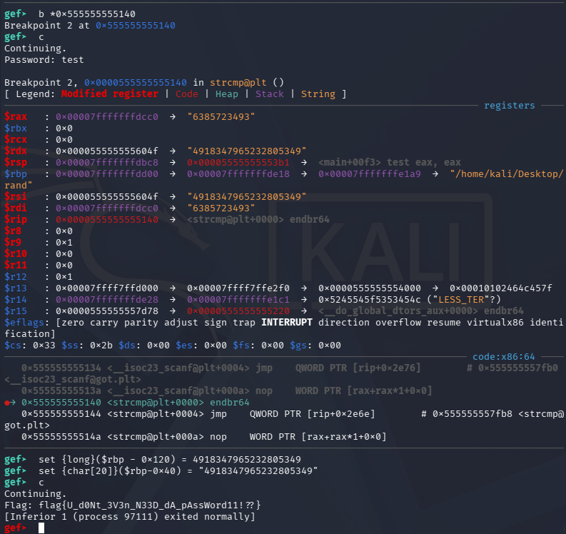

This has revealed the flag, which is now visible in plaintext. As such, the program has successfully been reversed engineered.

For clarity, the following commands need to be run in order to achieve this:
```
gef ./rand
set environment LD_PRELOAD=./ptrace.so
b main
r
disas main
b *0x555555555140
c
set {char[20]}($rbp-0x40) = "4918347965232805349"
set {long}($rbp-0x120) = 4918347965232805349
c
```