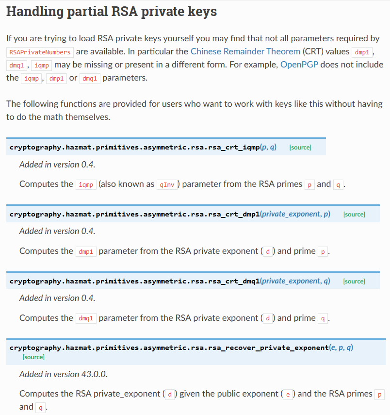
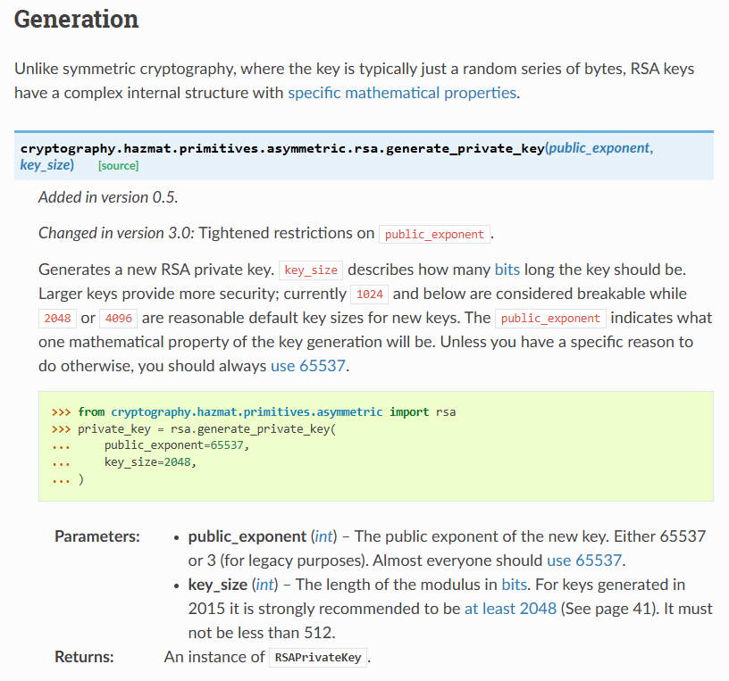
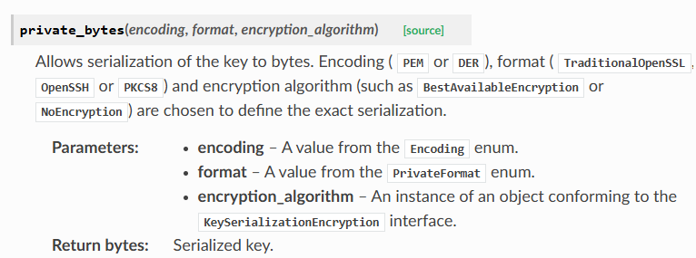
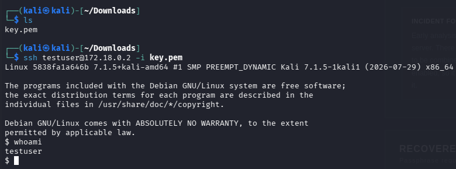

For this challenge, the only thing that we have access to is `rsa.enc` which looks like the following:
```
n1 = 608274...712081

c1 = 201700...036721

e1 = 3

n2 = 608274...712081

c2 = 297771...598737

e2 = 5
```
This includes 6 different values - `n1`, `c1`, `e1`, `n2`, `c2`, and `e2`. The file name including `rsa` indicates that we are dealing with the RSA encryption algorithm, which means we know what each of these values represent. `c` is the ciphertext which we are trying to convert into plaintext, and `n` and `e` are the public key components. As there is nothing else to work on, we can assume that the goal is to convert the ciphertext (`c`) into plaintext (`m`). 

One of the first things to notice about these values is that there is a red herring; `n1` and `n2` are the same value. This is important information because it narrows down what we can do with these values. However, given that we have two different ciphertexts with the same modulus `n`, it can be assumed that we are going to perform a common modulus attack. As `e1` and `e2` are specifically coprime, this possibility becomes even more likely.

Bezout's theorem can be used to decrypt the ciphertext to retrieve the plaintext message. As we know that `e1` and `e2` are coprime, then `gcd(e1, e2) = 1`. By Bezout's theorem, this can be used to compute `m` from `c1` and `c2`.
```
from math import gcd

n = 608274...712081
c1 = 201700...036721
e1 = 3
c2 = 297771...598737
e2 = 5

# Adapted from https://susanou.github.io/Writeups/posts/RSA-Common-Modulus/
s1 = pow(e1, -1, e2)
s2 = (gcd(e1, e2) - e1*s1)//e2
temp = pow(c2, -1, n)
m1 = pow(c1, s1, n)
m2 = pow(temp, -s2, n)
print((m1 * m2) % n)
```

This results in the following value:
```
24855301821421549348704050020767991187216845321802454677191021172040676253112653170393885875253339310670977282755774904952155588415060425919359452742325944478438227952655259251193204434207863530072927018279439921853249351898709715161192274307992740812153018735054511871845051741163118368686606673280466222408303510656747323816669183086890447541784855508872285624991646328345643056687600999743507344938368387365884405322060537716174640625844644467554477748577936654109256204276282061507101033831101311916180932819745412367574848563805319458590706781538625770904977341551165083105210860644035575096141973536633499558383
```

Using the other value gained from the `rip` manipulation challenge, we can now try and retrieve the flag for this challenge. The dashboard for Team Alpha says that the information can be combined in some way to gain access to the server. The output from the `rip` manipulation challenge started with `p =`, and since it is followed by a large number it is possible that the outputs of each challenge are the prime factors to an SSH key. Consequently, we must try and reconstruct the private key using `p` and `q`. 

Fortunately, the Python cryptography library has everything we need to do this and we can read the documentation (https://cryptography.io/en/latest/hazmat/primitives/asymmetric/rsa/) to find some useful information. In this documentation, there is an `RSAPrivateNumbers` class which is initialised using the private number of the private key. It includes the `private_key()` method, which can be used to create a private key from the numbers provided. The only factors this class requires to be initialised is `p`, `q`, `d`, `dmp1`, `dmq1`, `iqmp`, `n`, and `e`. We have been provided `p` and `q` and `n` can be calculated from these factors, leaving only `d`, `dmp1`, `dmq1`, `iqmp`, and `e`. Fortunately, the documentation has a whole section on handling partial RSA private keys and provides methods to calculate `d`, `dmp1`, `dmq1`, and `iqmp`. \


The documentation says that `iqmp` can be calculated from `p` and `q`, `dmp1` can be calculated from `d` and `p`, `dmq1` can be calculated from `d` and `q`, and `d` can be calculated from `e`, `p`, and `q`. Consequently, the only factor we need to find a value for is `e`. However, we don't even need to find a value for this either; the documentation gives some standard values for `e` in the private key generation section which we can utilise. \


Since we haven't been provided `e`, we can only assume it is either 3 or 65537. However, we will try it with 65537 first since that is the value the documentation says should always be used so it seems like a reasonable assumption that the key also used this value. 

Now that we have all the required values, we can create a Python script that creates the private key. However, we need to write this private key to a file so that we can use it to log into the machine. The documentation says that private key objects have the `private_bytes()` method which can be used to serialise the key to bytes which is exactly what we need. \


In order to serialise the key, we need to specify three parameters; the encoding, the format, and the encryption algorithm. The encoding can be assumed to be `PEM` since that is the most common format for SSH keys. The format can be assumed to be `OpenSSH` since that fits the SSH requirement the best. The encryption algorithm can be assumed to be `NoEncryption` since the only other types are `BestAvailableEncryption`, which requires a password we don't have, and `KeySerializationEncryption`, which is unsupported for this format. Now that we have decided how to serialise the key, it can be written to a file so that we can sign into the machine over SSH.

```
from cryptography.hazmat.primitives.asymmetric import rsa
from cryptography.hazmat.primitives import serialization

e = 65537
q = 248553...558383
p = 306375...216561
n = p*q

# Recover d for the private key
d = rsa.rsa_recover_private_exponent(e=e, p=p, q=q)

# Recover the CRT values
iqmp = rsa.rsa_crt_iqmp(p=p, q=q)
dmp1 = rsa.rsa_crt_dmp1(private_exponent=d, p=p)
dmq1 = rsa.rsa_crt_dmq1(private_exponent=d, q=q)

# Generate the RSA key for the found values
public_nums = rsa.RSAPublicNumbers(n=n, e=e)
numbers = rsa.RSAPrivateNumbers(p=p, q=q, d=d, iqmp=iqmp, dmp1=dmp1, dmq1=dmq1, public_numbers=public_nums)
private_key = numbers.private_key()

# Serialise the key to OpenSSH format
serialised = private_key.private_bytes(
    encoding=serialization.Encoding.PEM,
    format=serialization.PrivateFormat.OpenSSH,
    encryption_algorithm=serialization.NoEncryption()
)

with open("key.pem", "wb") as file:
    file.write(serialised)
```

This will write the private SSH key to a file called `key.pem`. The only remaining thing to find is what user this key can be used with. The "Incident Follow-Up" section on the dashboard says that the `testuser` account is still enabled, so this seems like a good candidate to test. We can attempt to log in to the machine using `ssh testuser@<IP> -i key.pem`, which if we've done everything right should log us into the server. \


This has allowed us to successfully log in to the server as `testuser`, meaning that our key creation was successful.