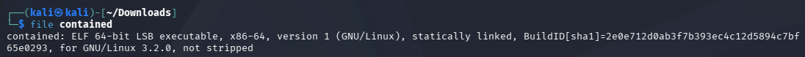
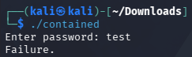
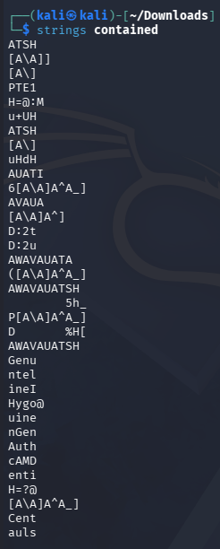
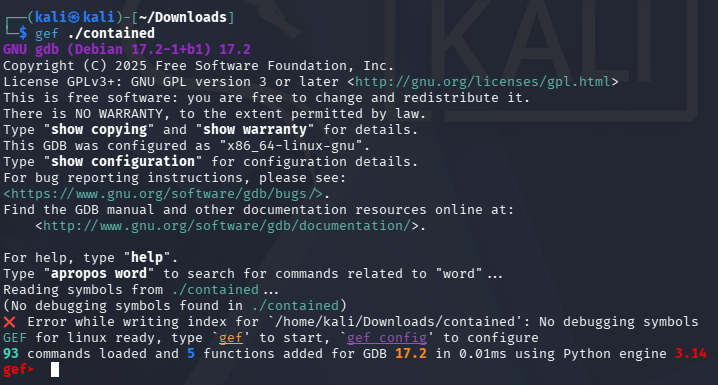
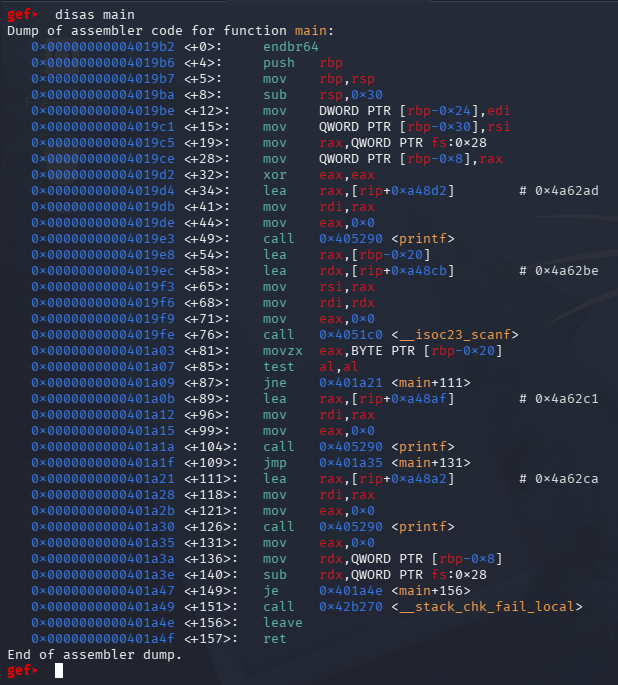
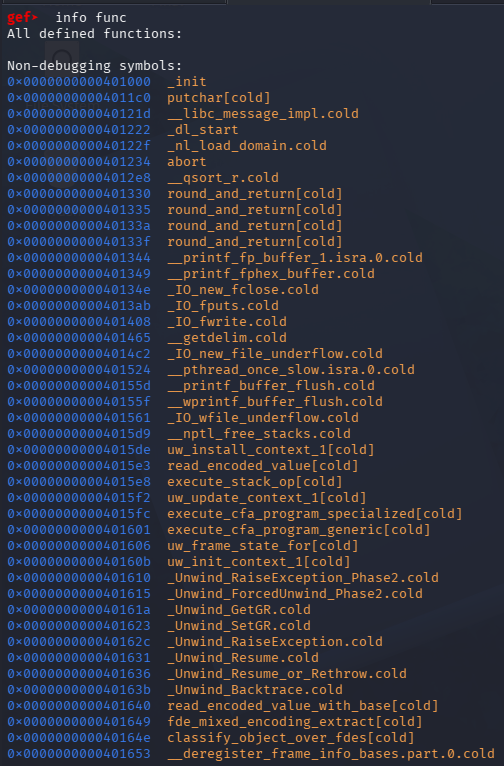
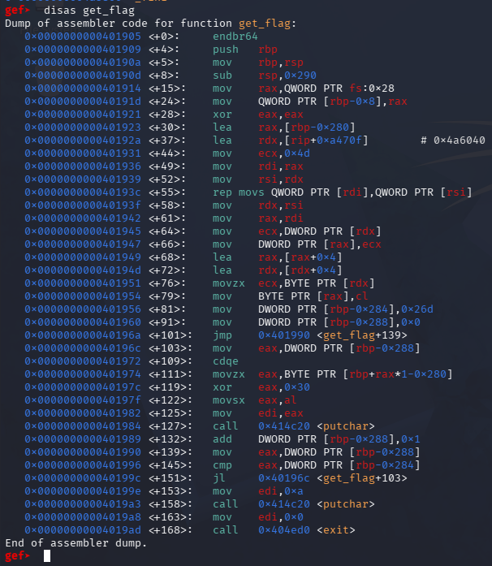
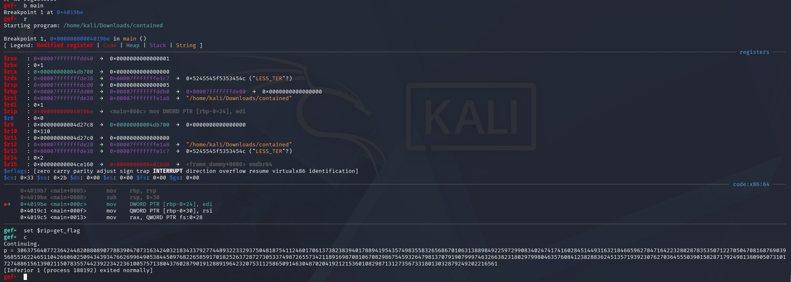

For this challenge, the only file we have access to is the `contained` binary. No specific information about the binary is mentioned on the dashboard, so we have to find this information ourselves. The first thing we can do is inspect the binary using `file contained` to gain some information about its structure and how it was compiled. \

The binary seems to be pretty standard, with the only notable aspects being that it is statically linked and not stripped. This doesn't mean anything to us right now, so we need to find some more information. Naturally, the next step is to actually run the binary and see what it does. \

The binary asks for a password, but we don't know what it is so it returns failure. It is possible that the password has been written in plaintext in the binary, so we can dump the strings from the binary to investigate. \

Evidently, there is a lot of noise in the binary and there is a large number of strings that have been dumped in the binary (significantly more than shown due to screen size limitations). This is likely because the binary is statically linked, so it is dumping every string in the libraries that have been linked in addition to the strings from the binary itself. This makes it hard to determine what is unique to the binary an what was from one of the linked libraries, so we need to take another approach to find information. A debugger can be used to see how the binary functions internally, so we can try and inspect it using `gef ./contained`. \

The first thing we can try is to disassemble `main` to see what it does, which can be done using `disas main`. \

Inspecting this disassembly, there doesn't seem to be anything of note. There are only standard function calls (`printf` and `scanf`), with no custom functions called. However, to be sure that there are no custom functions, we can list all the defined functions using `info func`. Although nothing is called by `main`, a debug function or something may still exist in the binary that we may be able to interact with. \

As expected, there are a lot of functions due to the previously identified static linking. This has created a lot of noise, which is the same problem we had when dumping the strings in the binary. After going through the whole list, there is a function that stood out; the binary defines a function called `get_flag`. This is not part of any library and not called by `main` so its purpose isn't clear, so this is worth investigating further. To see what it does, we can disassemble it using `disas get_flag`. \

This functions appears to be doing quite a bit more work than `main` does. There are several `putchar` function calls, which is likely where the flag is printed. Although this function is not called from `main`, it doesn't need to be; we can directly manipulate the `rip` register, which stores the memory address for the next instruction to execute, using our debugger. This is done using `set $rip=get_flag`, which will cause the `get_flag` function to be executed. \

This prints an extremely large value, beginning with `p = `. Although this currently means nothing to us, the dashboard says that the information gathered from the files can be combined in some way in order to gain access to the system. Consequently, we need to try and find the vulnerability in the other file in order to see how this value can be used.