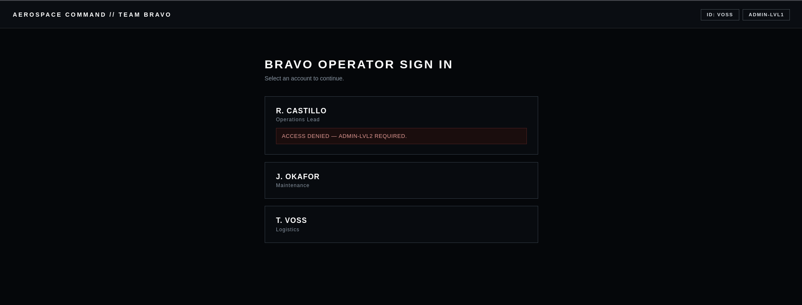
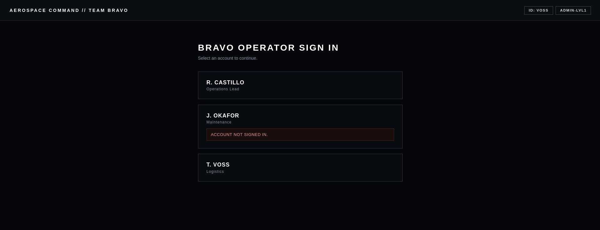
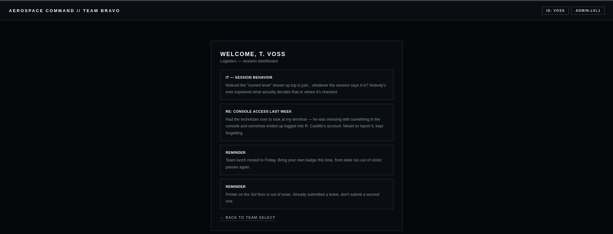
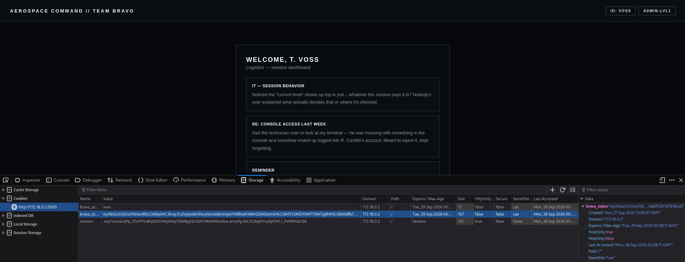
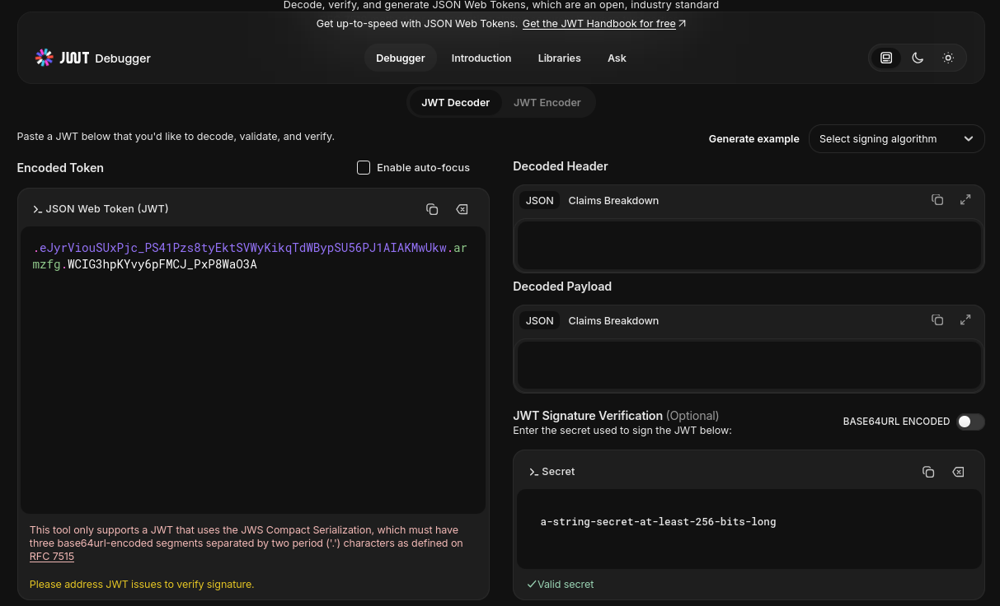
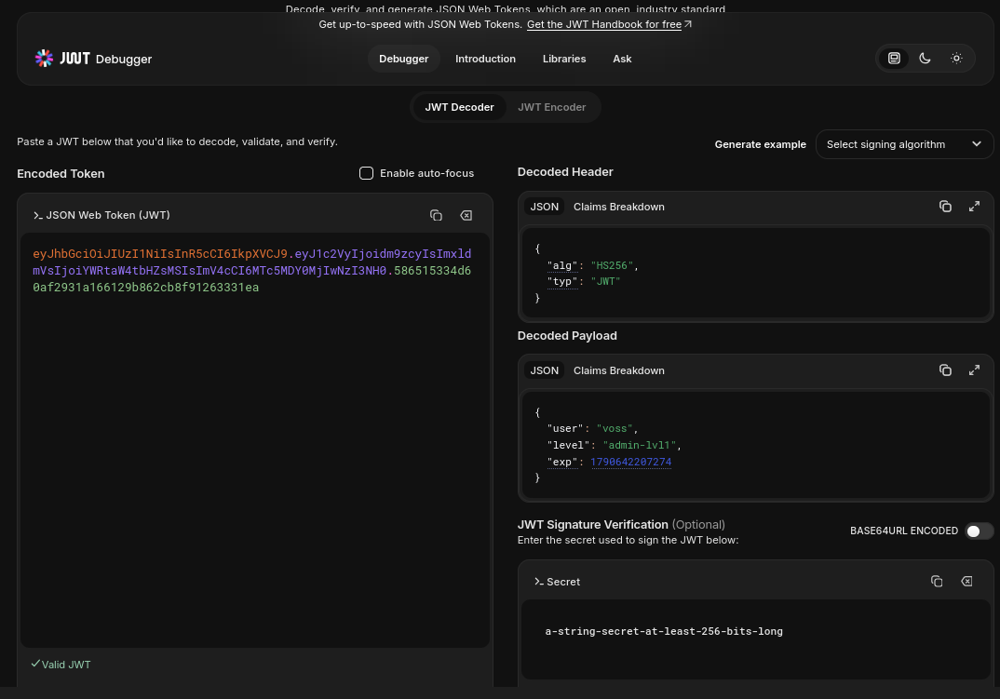
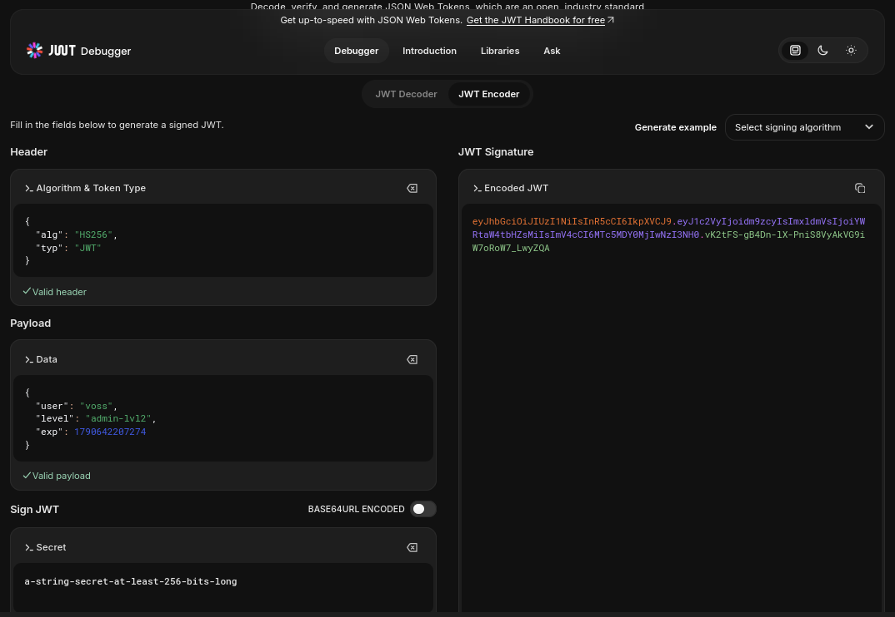
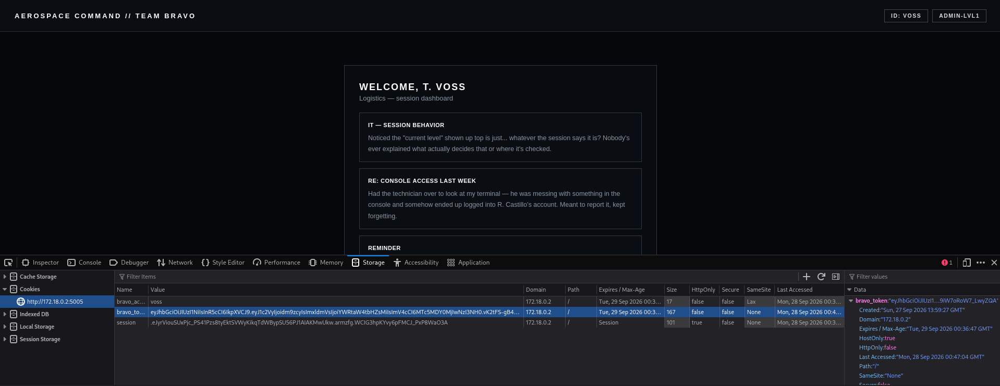
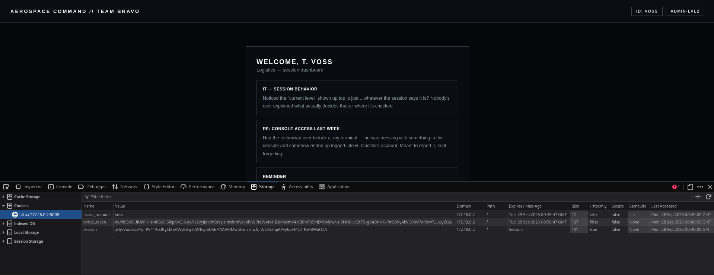
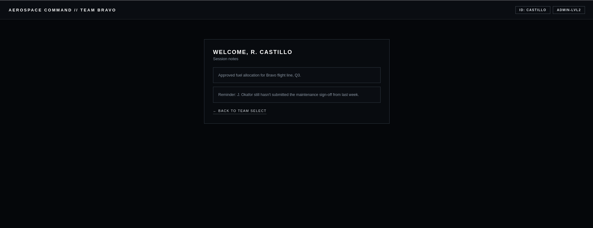

On the Team Bravo dashboard, there are three sections - one for each operator in Team Bravo. The obvious thing to do at this point is try to sign in as each of these accounts and see what we can access. \
 \
 \

It looks like we need to be a level 2 admin to sign into Castillo's account, while we are only a level 1 admin (which we can see on the top right). We were also denied from Okafor's account, with a generic "not signed in" error. However, we can access Voss's account which aligns with our ID on the top right. Now that we have access to Voss's account, we can read the notes that have been left behind. From these notes, the first two seem to be the most important. They mention that the current level is provided by the session rather than being verified by the server, and it seems possible to use the console to sign into another user's account (specifically Castillo's, which is probably our target). It is likely that the session is being stored as a cookie on the browser as this is a typical setup, so this seems like the most obvious place to check. \

It looks like there are three cookies, but the ones of interest are `session` and `bravo_token`. These are both appear to be encoded as JavaScript Web Tokens (JWTs), so we need to find the cookie that encodes the user's current level. This can be done by decoding both and inspecting their contents using an online tool like https://www.jwt.io/. \
 \

Attempting to decode the `session` cookie failed due to not being an actual JWT, but decoding the `bravo_token` cookie was successful. After decoding it, we can see that it contains three fields; `user` (the current user ID), `level` (the user's current level), and `exp` (the cookie expiry time). As the dashboard said that we need to be `admin-lvl2` in order to sign in as R. Castillo, we can try setting our level to this using an online JWT encoder and setting the resultant token as our own `bravo_token`. \
 \

Now that the new `bravo_token` has been set with the `level` set to `admin-lvl2`, we can try to refresh the page to see if this has influenced our level. \

As shown, this has successfully changed our admin level to `admin-lvl2`. Consequently, it should be possible to access R. Castillo's account since this was the only requirement so we can try and do this now. \

As expected, we are now able to access Castillo's account.