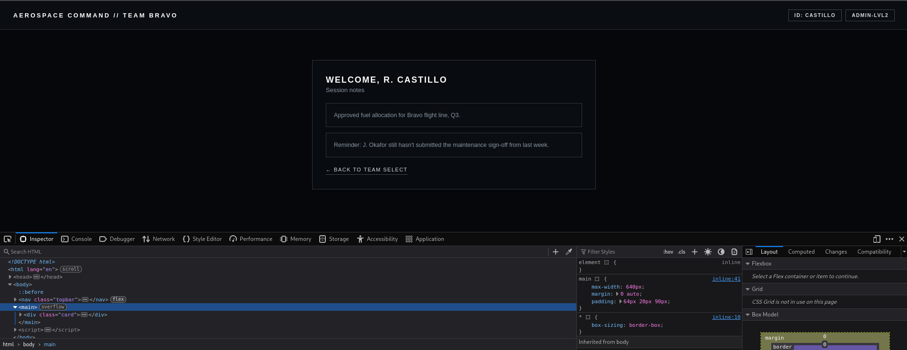
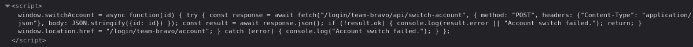
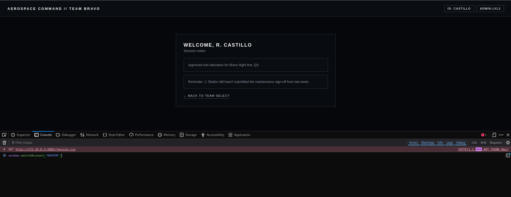
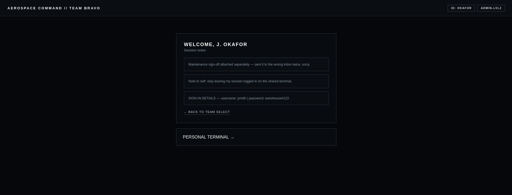

Now that we have gained access to Castillo's account, the next target is likely to be Okafor's account. Castillo's session notes mention Okafor, signalling that this is our target. However, these session notes don't mention anything else so we need to perform some reconnaissance to find how to sign in as Okafor. Using the browser's developer tools to do this seems like a natural step, so we can try this first to see if we can find anything. \

By default, the developer tools will open the current page's DOM inspector (the name will vary by browser, but this tool allows anyone to view the raw HTML elements that make up a web page). The interesting thing is that, unlike the previous pages, there is a `script` tag in the body of the page. This seems highly suspicious, so we can should open it and see what it does. \

This script defines a function called `switchAccount` on the global `window` object that seems to call an API to switch the user's current account. This function takes a single parameter which is the account's ID. As our target is Okafor's account, we need to find what their account ID is. A reasonable assumption would be that the ID is "OKAFOR", since the ID of Castillo's account was "CASTILLO" and the ID of Voss's account was "VOSS". We can try this by running `window.switchAccount("OKAFOR")` in the browser's console, which will call this function for us. \
 \

This has successfully changed our account to Okafor's, which provides credentials and a terminal for the next challenge.