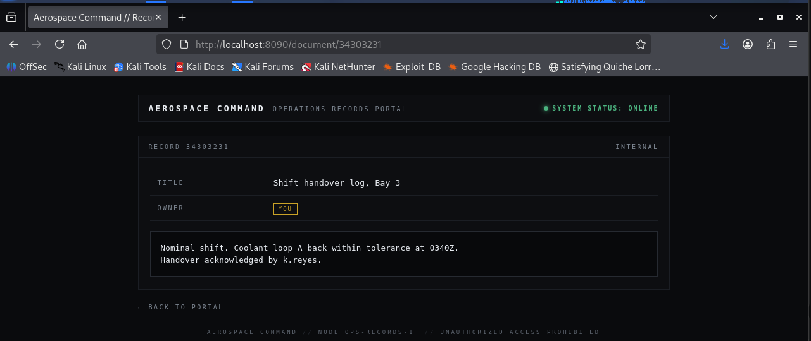
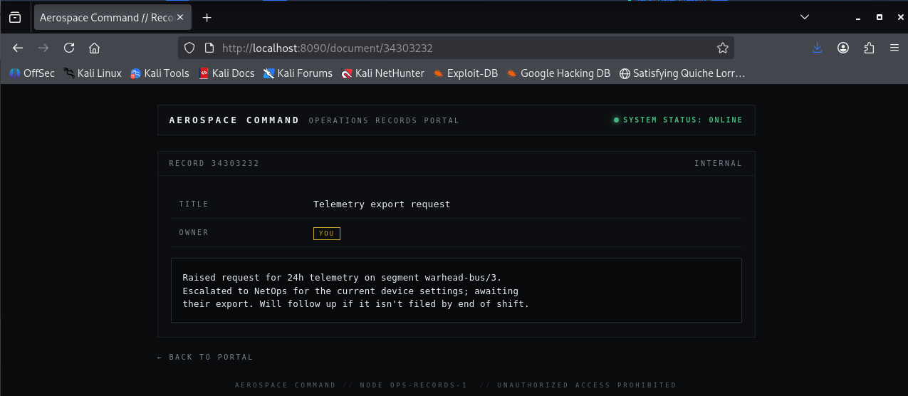
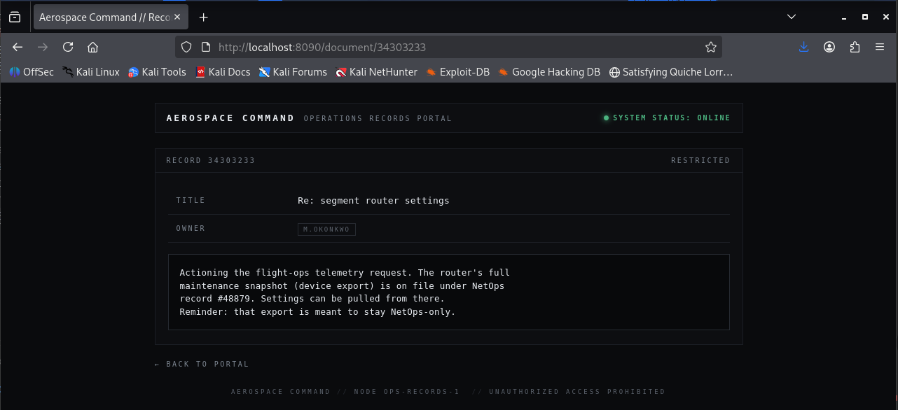
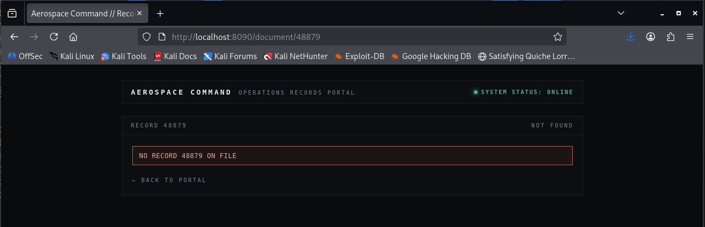
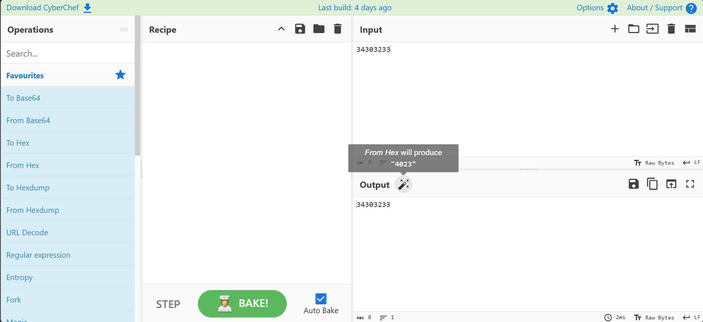
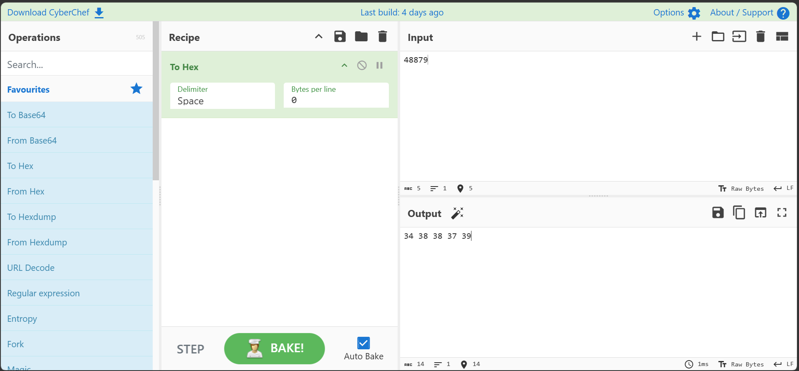
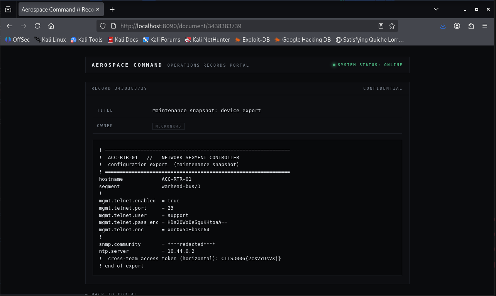

The panel shows the document records for the current user, with the only two available being `34303231` and `34303232`. The panel says it is encoded, but does not specify the encoding so we need to do some more investigation. The first thing to try would be to read the documents available to see if they say anything of interest. \
 \

After reading the contents of both of these documents, there doesn't seem to be anything useful. However, the URLs for each document are interesting; they follow the `/document/<number>` format specified on the panel, so we may be able to try and look at other documents by changing this value. As a test, we can try and navigate to `/document/34303233` to see if there is any additional information we can get access to. \

This has allowed us to view an additional document, despite it not being on our dashboard. This document specifically belongs to M. Okonkwo, meaning that our permissions aren't being checked when accessing documents which we may be able to take advantage of. This document specifically says that there is, supposedly, a maintenance snapshot for NetOps under document 48879. This is something we should probably look at, so let's try navigating to `/document/48879` to see if we can find anything. \

This has returned that there is no results, so 48879 likely refers to the decoded number in the header. Therefore, we need to try and find what encoding scheme the URL uses to try and view this document. So far, all we know is that the document encoding can contain numbers which isn't very helpful as many encoding schemes can contain numbers. CyberChef contains many tools to encode and decode tools, so we can try different encoding schemes to see how this value is encoded and try to apply it to 48879. \

CyberChef has suggested to decode this value using Hex, which converts 34303233 to 4023 (in decimal). This is worth exploring, so we need to convert 48879 to Hex and then attempt to use that as the URL parameter. \

Converting 48879 to Hex has resulted in 34 38 38 37 39, or 3438383739 which is a familiar format. Now all we need to do is try and access `/document/3438383739` and see if we get a result. \

This has successfully retrieved the maintenance snapshot referred to earlier, which has a lot of information. Among this information is the flag for this challenge, which is `CITS3006{2cXVYDsVXj}`.

This is an Insecure Direct Object Reference: the portal returns a record based purely on the identifier in the URL and never checks whether the logged-in operator is authorised to view that record. Hex-encoding the record number is not access control, only obscurity, and is trivially reversed, so an attacker can enumerate and read other users' records. It is mitigated by enforcing per-object authorisation on the server for every request, using unpredictable identifiers, and never treating the encoding of an identifier as a security measure.
