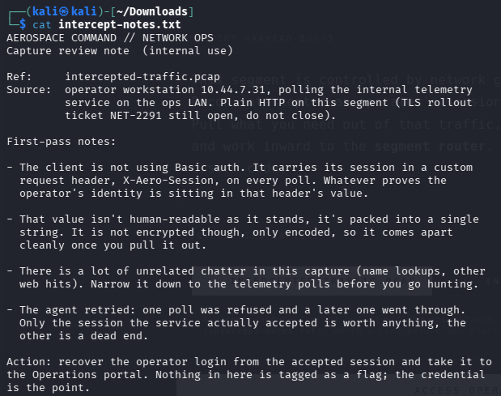
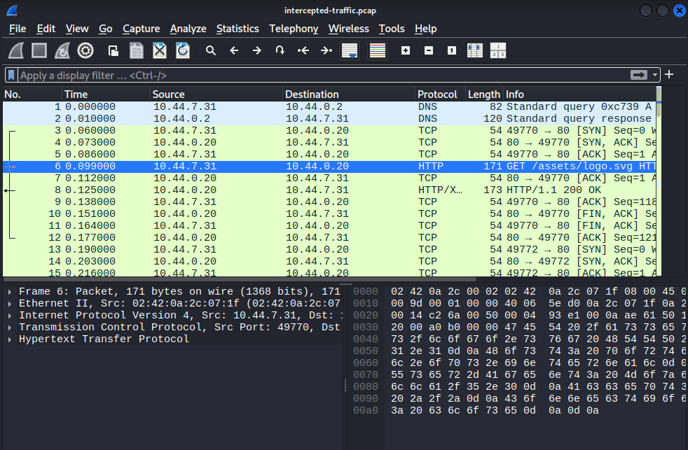
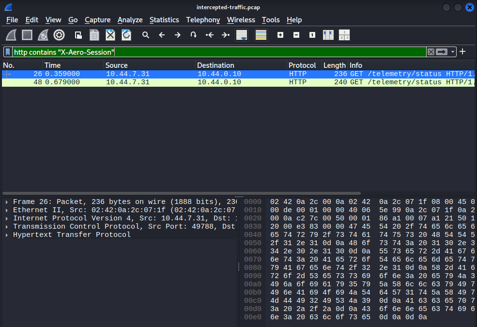
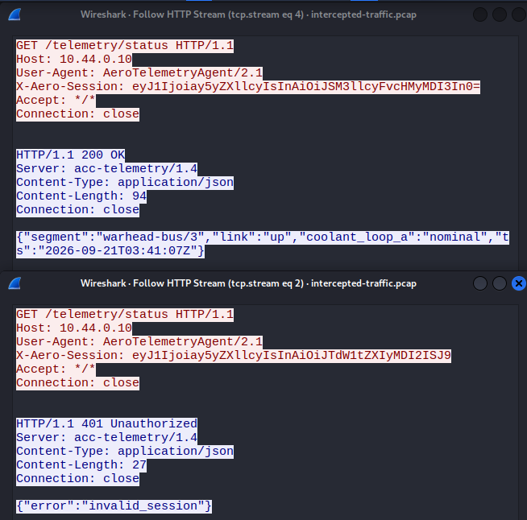
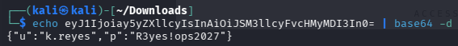
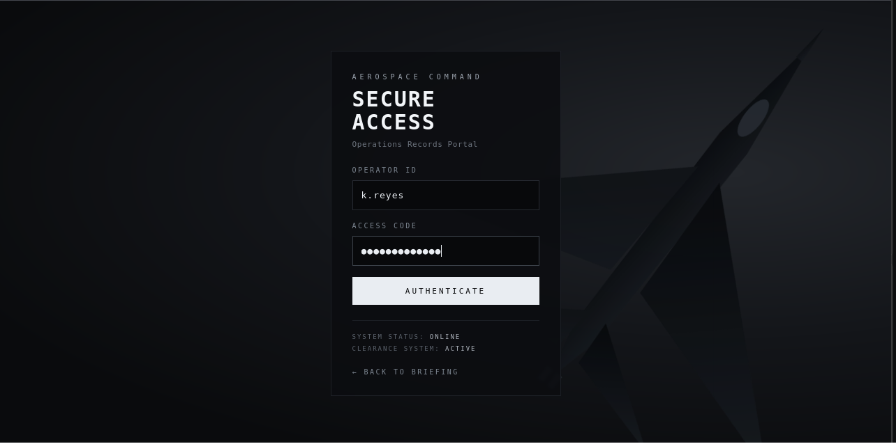
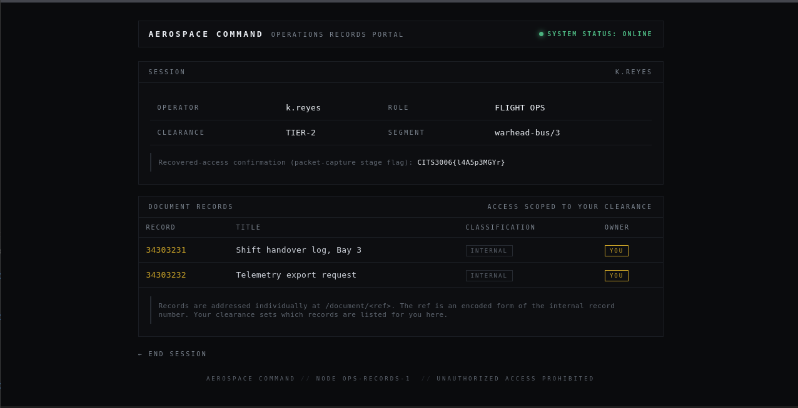

The dashboard says that the operations portal needs some credentials that we don't currently have. Fortunately, the Recon team intercepted an operator's session and saved it. From here, we can inspect the intercepted session to try and get the credentials to log into the portal. The dashboard provides two files; `intercepted-traffic.pcap`, the intercepted session, and `intercept-notes.txt`, notes from the Recon team about the session. As these are both embedded downloads, we can download both of these to our host for further inspection. The notes are likely to hold information regarding what we should be looking for, so we should read this first. \

From these notes, we can gather a few bits of key information about where to look for the credentials:
- It is being transmitted over HTTP
- The auth token is stored in the `X-Aero-Session` header in every request
- The value of the auth token is encoded in some format
- The token is in the telemetry polls
- There are two different requests to the telemetry polls where one went through and the other did not
Using this information, we can now inspect the packet using Wireshark. \

There is a lot of information here, so we can narrow it down according to the notes. As we know the credential is stored in a HTTP packet with the `X-Aero-Session` header, we can filter to only these packets with `http contains "X-Aero-Session"`. \

This has narrowed us down to two packets, which is just as the notes indicated. These both access `/telemetry/status`, so both need to be inspected to find the credential. \

It looks like the first request (`tcp.stream eq 4`) went through and the second request (`tcp.stream eq 2`) failed. Consequently, we can assume that the first request auth token (`eyJ1Ijoiay5yZXllcyIsInAiOiJSM3llcyFvcHMyMDI3In0=`) is the one we are looking for. 

Although we know that it is encoded, we don't know how it is encoded. However, there is an `=` sign at the end of the token. This is common with Base64 encoding, so we can try and decode it and see if we get anything. This can be done on our host using `echo eyJ1Ijoiay5yZXllcyIsInAiOiJSM3llcyFvcHMyMDI3In0 | base64 -d` and looking at the output. \

After decoding, it looks like the username is `k.reyes` and the password is `R3yes!ops2027`. Now that we have the username and password, we can try and sign into the operations portal using these credentials to see if they work. \

After authenticating, these credentials were accepted and we are brought to an operations record panel. \

This has revealed the flag for the challenge, which is `CITS3006{l4A5p3MGYr}`.