Looking at the output of the maintenance file, we can see that it says `ota-firmware::http://ROUTER-HOST:8081/fw/1edca15d3306/acc-rtr01-fw.elf`. This seems to indicate that some sort of firmware is stored at `http://ROUTER-HOST:8081/fw/1edca15d3306/acc-rtr01-fw.elf`, which we can download onto our host using `wget http://localhost:8081/fw/1edca15d3306/acc-rtr01-fw.elf`. \
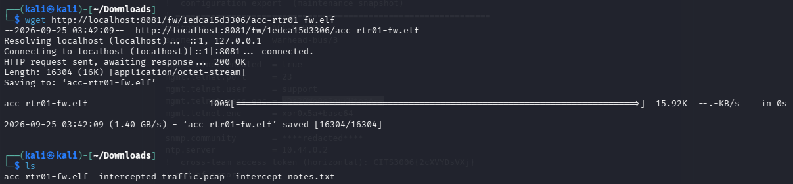

Before we do anything, the binary will be renamed to `bin` so that it is easier to interact with in the shell. \
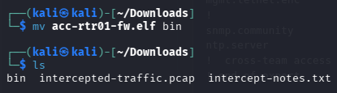

Now that we have the binary on our system, we can inspect it to see what it does. We can see what it does by calling `./bin` after making sure it is executable with `chmod +x bin`. \
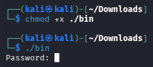

The program is asking us for some sort of password, which we obviously don't have. However, we should see what it does given input anyway since that could guide us to what we have to do. \
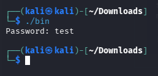

After trying a random password, the program literally returns nothing. We can try to check any embedded strings in the program using `strings bin`, which may contain the password for the binary in plaintext. \
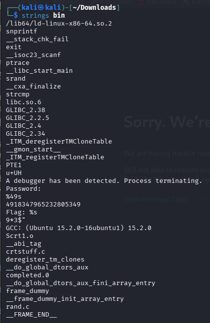

The strings seem to primarily be referencing functions, but there are some notable strings that can be seen in the binary. There's the password entry text, a random string of numbers (`4918347965232805349`), and a piece of string that seems to imply that the flag is printed somewhere (but likely obfuscated in some form). The string of numbers is interesting, and could be the password so we can try it and see what happens. \
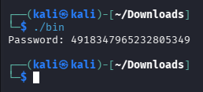

This has also caused nothing to happen, so we need to investigate something else. We can also inspect the properties of the binary using `file bin`, which may have something that can be exploited. \
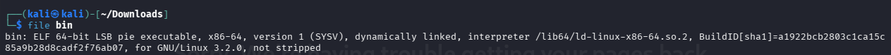

This appears to be a fairly standard binary. However, it is dynamically linked meaning that libraries are loaded at runtime instead of at compile time. This means it could potentially be vulnerable to an `LD_PRELOAD` attack, but we have to find a function that can be bypassed to actually exploit this. It is also stripped, meaning that we may be able to view function names through a debugger. Since we have access to the binary on our local machine, we can attach it to a debugger (like `gef`) to see how it works internally and identify any functions which could be bypassed using this method. \
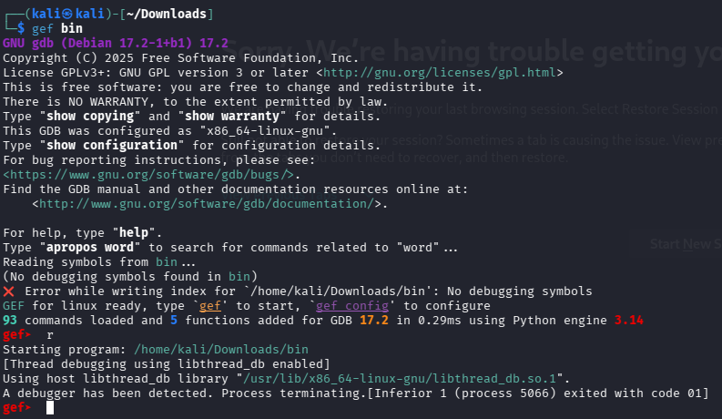

After attempting to run it with the debugger, it leads to an error. It is likely using some anti-debugger technique to prevent it being run in debuggers, which we can check using `disas main`. \
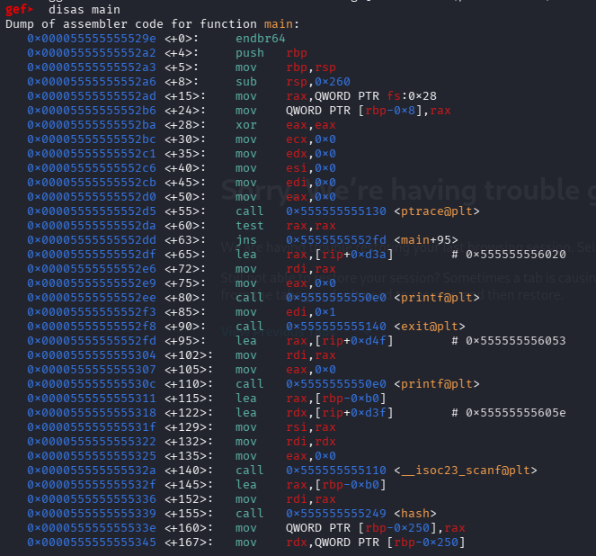

This disassembly has shown a `ptrace` function call, which is commonly used to prevent programs being debugged. By taking advantage of the fact that this binary is dynamically linked, we can write a custom implementation of this function that allows us to bypass this check entirely. All this needs to do is return 0, and can be written like the following:
```c
long ptrace(int request, int pid, void *addr, void *data) {
    return 0;
}
```
To make this available as a shared library, it can be compiled as `gcc -shared ptrace.c -o ptrace.so`. \
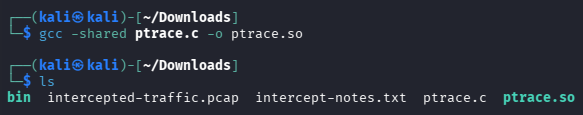

Now that the library has been compiled, we can load it when we start running the program. This can be put into the environment using `set environment LD_PRELOAD=./ptrace.so`, which will cause any `ptrace()` call to use this function instead. \
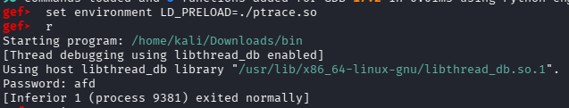

Now that we have access to the program, we can investigate it further. We still don't know what the password is, so we need to find some further information. As we know the binary isn't stripped, we can have a look at some of the functions the binary includes. \
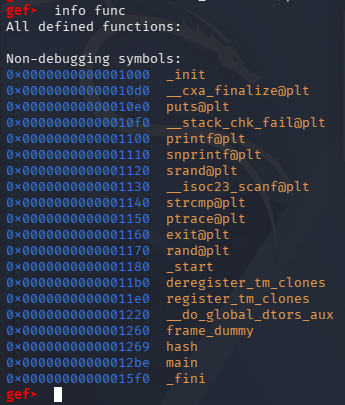

These are all C and system functions, with the exceptions of `main` and `hash`. `main` isn't interesting since all standlone C binaries will include one, but `hash` is interesting and likely indicates that the password is hashed before being checked. We don't expect `hash` to contain any useful information since it just sounds like a hashing function, so exploring `main` again will be the next step. Just to make it easier, this will be done using Ghidra. \
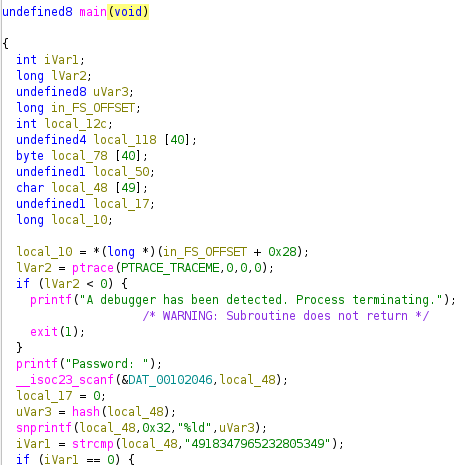

This decompilation of `main` produced by Ghidra has a few points of interest:
- The `ptrace` call terminates program execution if it succeeds
- The input is hashed and passed as a string
- The hash is compared to `4918347965232805349` (which is the string identified earlier)
To make viewing this decompilation easier, the variables can be renamed. \
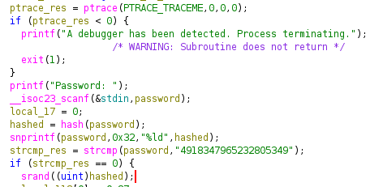

After cleaning up the decompilation, it seems like the hash value is used to seed a random number generator using `srand`. To confirm this, we need toenter this branch which we can do by finding a password that hashes to the value `4918347965232805349`. Although this could be brute forced, this will take a long time; instead, we can use `gef` to insert this value into memory just before the string comparison to enter this branch. This requires looking at the 
disassembled `main` function identify where the password input is stored in memory so we can adjust its value directly. \
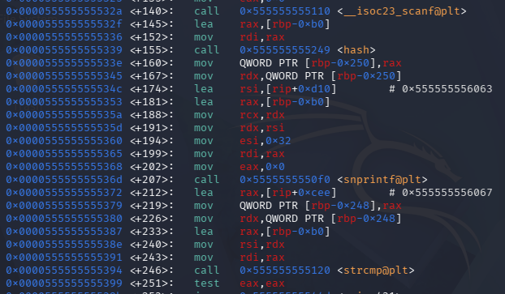

At various points, there are a few addresses that have data being transferred into them:
- `rbp - 0xb0`
- `rbp - 0x250`
- `rbp - 0x248`

The one that sticks out the most is in the instructions before the `hash` function is called. The `lea` instruction is used to move the memory held in `rbp - 0xb0` to the `rax` register. This is then moved to the `rdi` register, which is where the first argument for functions is stored. As the `hash` function is called directly afterwards, this seems like the perfect candidate for where password input is stored. To confirm this, a breakpoint can be placed just before the `hash` function (using `b *0x555555555249`) and the `rdi` register inspected. \
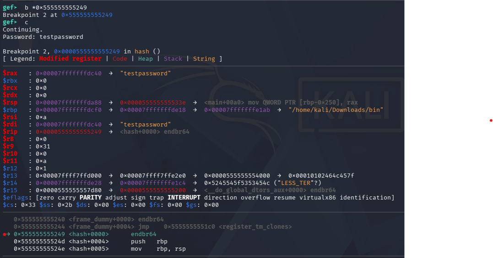

As expected, the `rdi` register (and `rax` register) contains the input password. Therefore, the input password is contained at `rbp - 0xb0`. We can utilise this fact to force this memory to be the hash value, bypassing the need to find the password entirely. This can be done by setting a breakpoint at the `strcmp` instruction (using `b *0x0000555555555391`), changing the value of `rbp - 0xb0` to the "correct" hash value using `set {char[20]}($rbp-0xb0) = "4918347965232805349"`, and then continuing function execution. \
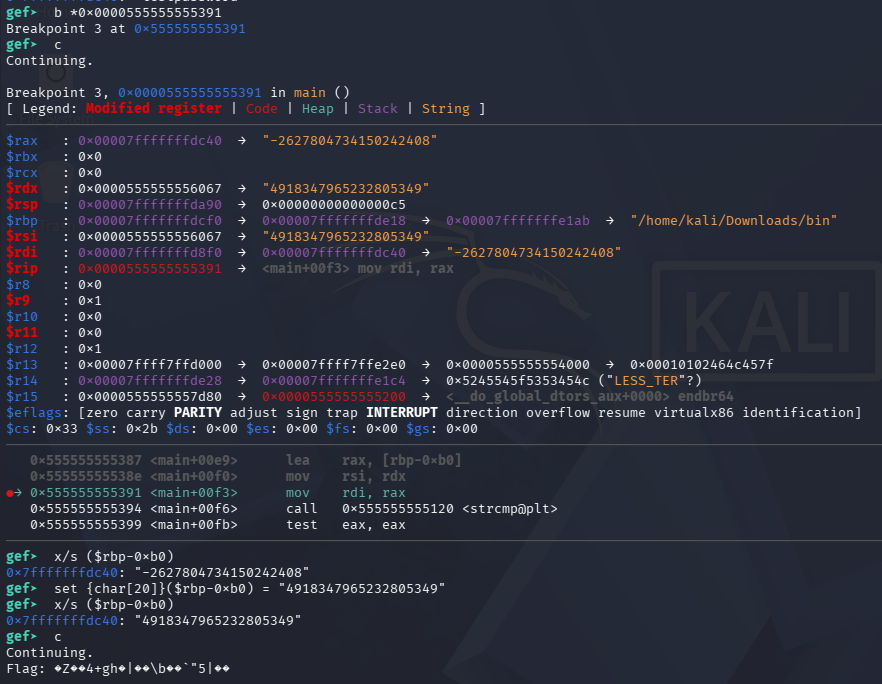

As shown, this has actually allowed program execution to continue within the branch but the output does not look as expected. This probably has something to do with the random seed identified earlier, which uses the hashed value as the seed. Since changing the value at `rbp-0xb0` only changed the string representation, we also need to change the value of the hash value itself. In the earlier disassembled code, `rbp-0x250` seems like a good candidate since that is the value accessed directly after the `hash` function returns so we can inspect that. \
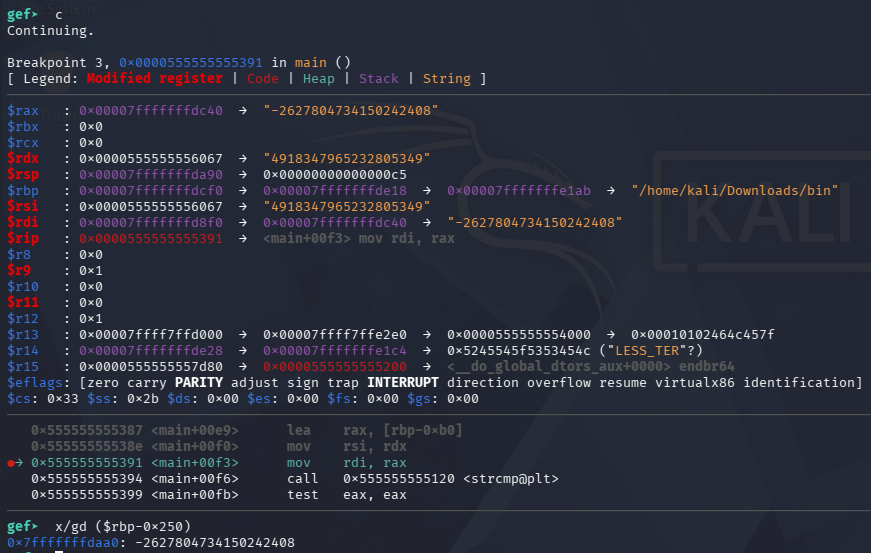

As shown, the address at `rbp - 0x250` holds the exact same value (in decimal) as `rdi` which, in this case, is the string representation of the hash of the password input. As such, it can be changed using `set {long}($rbp - 0x250) = 4918347965232805349` to ensure that both `rbp - 0x250` and `rbp - 0xb0` hold the same value. If both of these are changed and the program execution continues, the following results: \
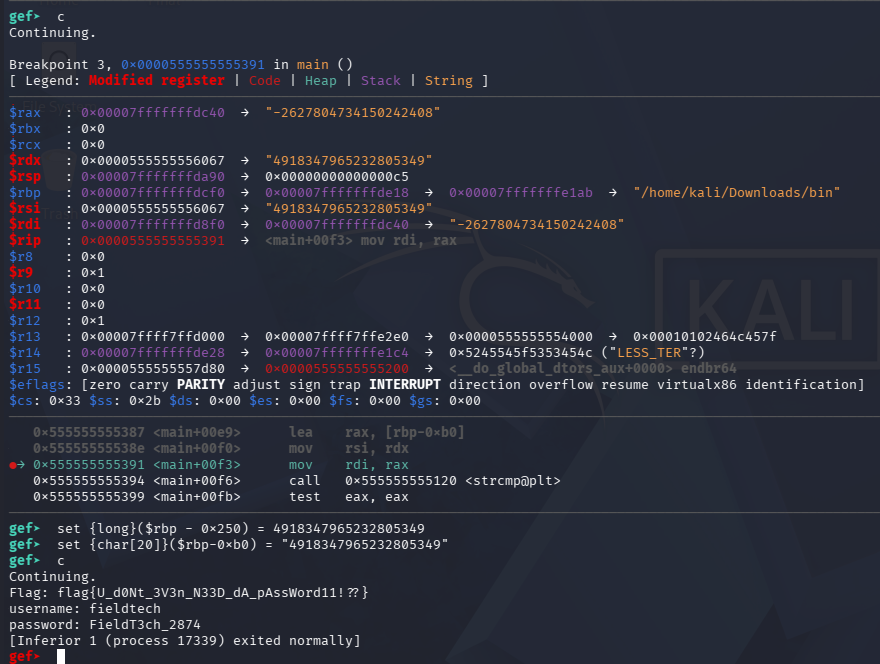

This has revealed the flag, which is `flag{U_d0Nt_3V3n_N33D_dA_pAssWord11!??}`. Some credentials have also been revealed, which will be required to complete the next challenge.