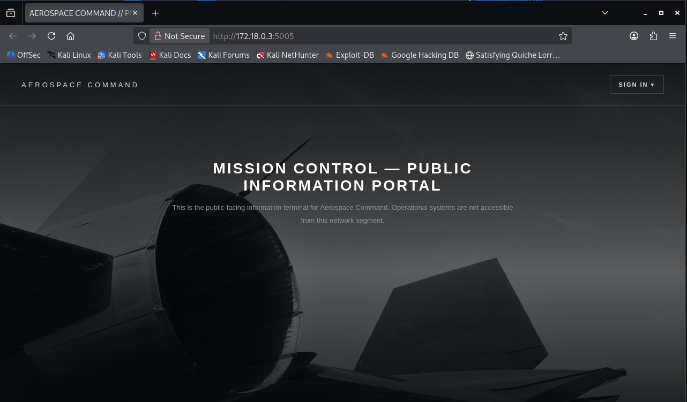
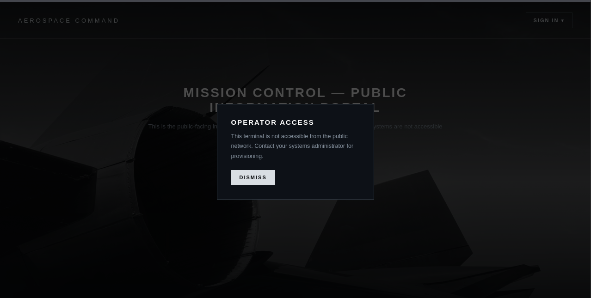
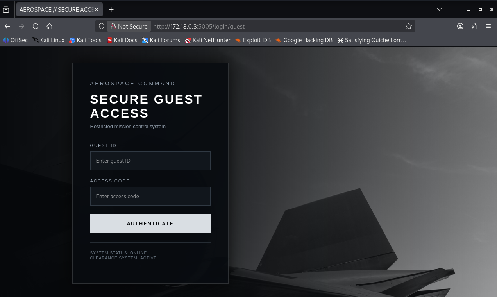
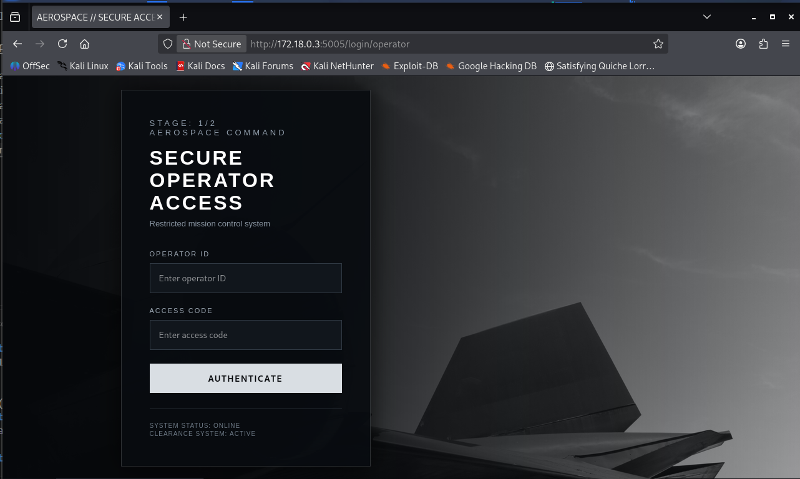
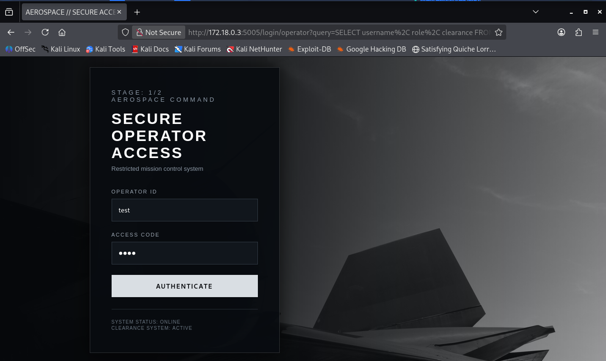
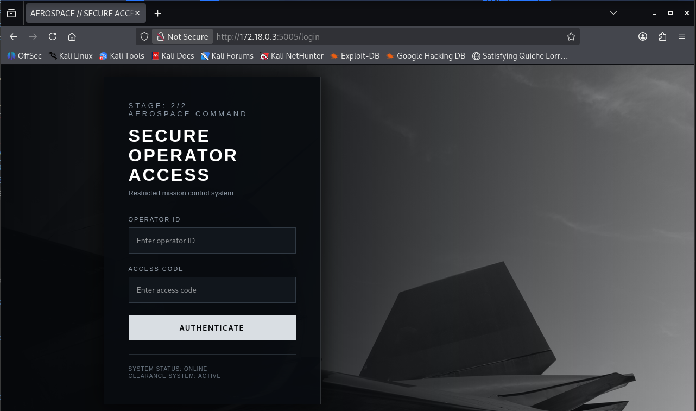
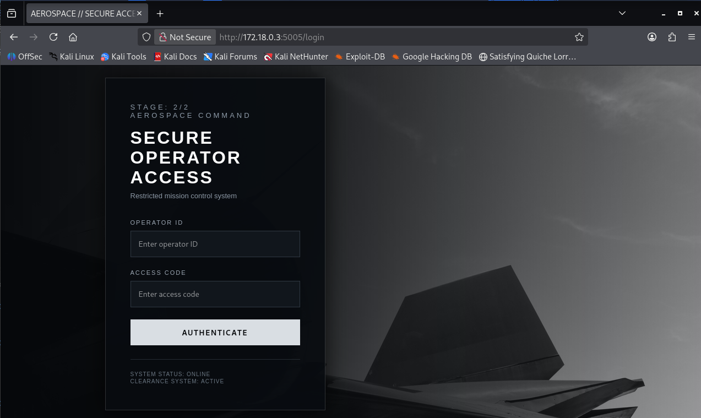
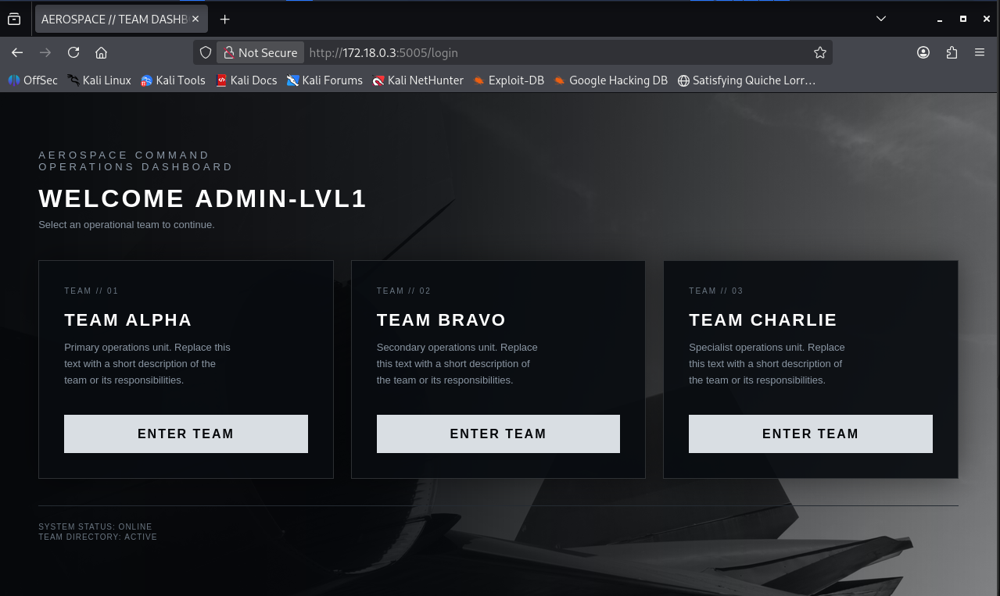

Once the application is started, the entry point is located at both `http://localhost:5005` or `http://<container_IP>:5005`. This will bring us to the following web page. \

The only option available to us is the "Sign In" option in the top right. This reveals 2 options - "Guest Access" and "Operator Access". Obviously we want as much privilege as possible, so we will try "Operator Access" first. \

This leads to an error that it cannot be accessed. We should keep this in mind for later, but the only option left now is to try "Guest Access". \

This has led us to a fairly standard login panel. However, we don't know any credentials so this must be able to be exploited some other way. The URL leads to the path `/login/guest`, so we can try and access the operator panel by navigating to `/login/operator` and seeing if that works. \

This has led to the operator login panel, which means we are on the right track. There are a few things to note here; we need an operator ID/access code (likely just a username and password) and this is stage 1 of 2 apparently. We don't know any credentials yet so we should try to enter anything and see what happens. \

Visually this didn't change anything, but the URL changed with a new `query` parameter that appears to be an SQL query (`SELECT%20username%2C%20role%2C%20clearance%20FROM%20users%20WHERE%20username%20%3D%20%27test%27%20AND%20password%20%3D%20%27test%27` or `SELECT username%2C role%2C clearance FROM users WHERE username %3D 'test' AND password %3D 'test'` depending on the browser being used). This is URL encoded, but by decoding it we can see the query being executed is `SELECT username, role, clearance FROM users WHERE username = 'test' AND password = 'test'`. Since we can directly manipulate the query, this seems like the obvious solution. As we don't know the password, we can just remove this section entirely so that we only have to match the username. We don't know the username, but we can probably assume that one of them is `admin` or `administrator`. We can try this using the URL `http://localhost:5005/login/operator?query=ELECT%20username%2C%20role%2C%20clearance%20FROM%20users%20WHERE%20username%20%3D%20%27admin%27`. \

This had led to stage 2 of the login panel, indicating that `admin` was, indeed, a valid username. At this point we have no further information so we need to test this panel to see if anything happens. \

After entering some test credentials, there are no visual changes to the UI or URL so there must be another solution. Even after looking at the website's cookies and source code for any potential information, nothing can be found. As we have nothing else to work on, we can try to construct a basic SQL injection attack. This can be done using `' OR 1=1 --` as the username to see if anything happens. \

This has allowed us to login, showing the dashboard for the web application. The dashboard has three different "categories"; Team Alpha, Team Bravo, and Team Charlie. Each of these correspond to one of the three exploit paths, so we will visit these in order.